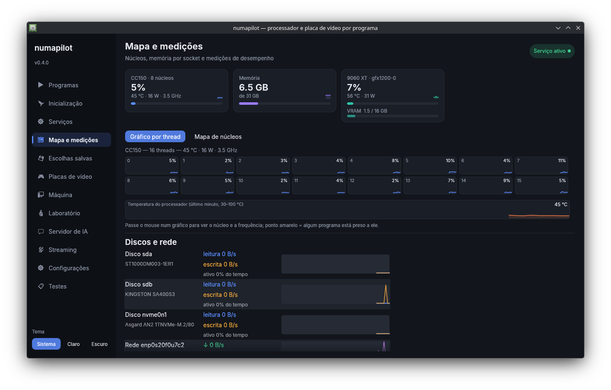
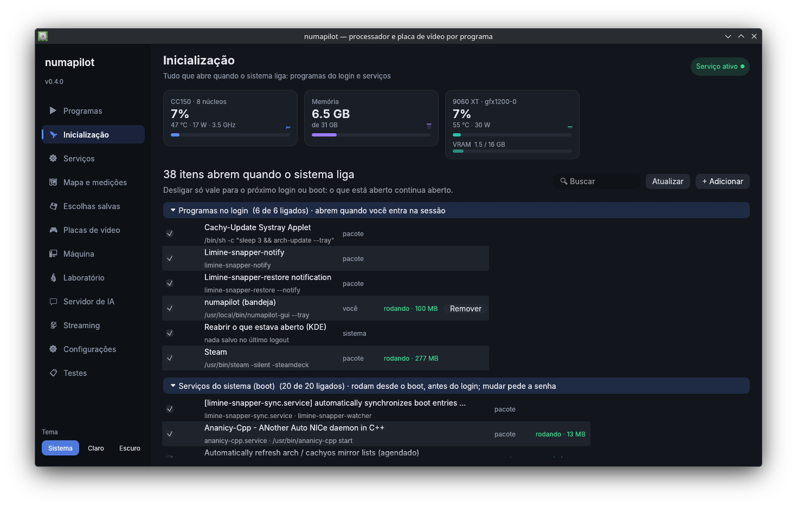
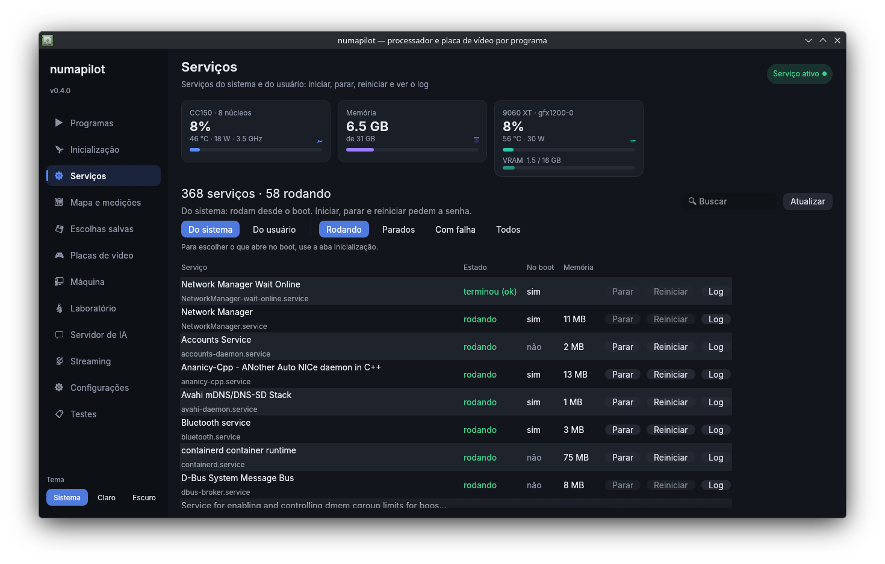
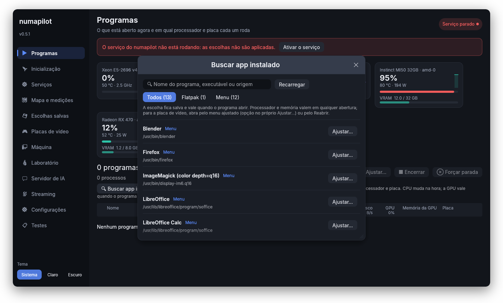

# numapilot

[](https://github.com/lucasfracaro/numapilot/actions/workflows/ci.yml)
[](https://github.com/lucasfracaro/numapilot/releases/latest)
[](LICENSE)


**Português** · [English](README.en.md)

[Instalar](#instalar) · [Capturas](#capturas) · [Interface](#a-interface-aba-por-aba) ·
[Linha de comando](#linha-de-comando) · [Notebook](#notebook) · [BC-250](#bc-250-e-bc-160) ·
[Novidades](CHANGELOG.md)

Gerenciador de hardware e programas para Linux (feito no CachyOS): **um app só para controlar
processador, memória, placas de vídeo, programas, serviços e o que abre com o sistema**, em
qualquer PC: de um servidor com 2 processadores e placas de IA a um notebook gamer ou uma BC-250.

Ele descobre o hardware e mostra só o que faz sentido para ele. Começou escolhendo **qual
processador (socket NUMA), qual memória e qual GPU** cada programa usa num servidor com
2× Xeon e 2× MI50, e cresceu para o resto do PC: ventoinhas, potência, undervolt, modos de
energia, saúde do hardware, inicialização e serviços (como o gerenciador de tarefas do Windows ou
o Mission Center), IA local, jogos e vários PCs num painel só.


## Capturas

| | |
|---|---|
| [](#placas-de-vídeo) **Placas de vídeo**: histórico, curva da ventoinha, clock e voltagem | [](#mapa-e-medições) **Mapa e medições**: cada thread, temperatura, disco e rede |
| [](#máquina) **Máquina**: modos, energia em kWh, saúde, processadores | [](#notebook) **Notebook**: bateria, NVIDIA só quando precisar, telas |
| [](#inicialização) **Inicialização**: o que abre com o sistema | [](#serviços) **Serviços**: systemd com estado, memória e log |
| [](#programas) **Ajustar…**: processador, memória e placa por programa | [](#bc-250-e-bc-160) **BC-250**: programas da comunidade, CUs, memória da GPU |

## O que ele faz

| Área | Destaques |
|---|---|
| **Programas** | tabela no estilo de um gerenciador de tarefas (CPU, memória, disco, GPU e memória da GPU por programa, ordenar, buscar), Encerrar/Forçar parada protegidos, e por programa: processador, núcleos, memória, prioridade e placa de vídeo |
| **Inicialização** | tudo que abre no login e no boot (programas, serviços, restauração de sessão do KDE): ligar, desligar, remover e adicionar (programa, AppImage, script ou comando) |
| **Serviços** | todos os serviços do systemd com estado e memória: iniciar, parar, reiniciar e ver o log |
| **Placas de vídeo** | temperaturas, ventoinha (curva ou fixa), limite de potência, clock/voltagem (OverDrive da AMD, curva da NVIDIA), **undervolt automático** com teste de carga, histórico, Resizable BAR, driver NVIDIA |
| **Máquina** | modos de um clique (Jogo, IA, Silencioso), governor/frequências/uncore/potência por socket, latência baixa em jogos, memória (NUMA, THP, hugepages), sched_ext, ventoinhas da placa-mãe, mitigações e parâmetros do kernel, notebook (bateria, NVIDIA híbrida, ryzenadj, Acer), energia em kWh e R$, saúde (SMART, ECC, bateria) |
| **Mapa e medições** | uso de cada thread no último minuto, temperatura, memória por socket, **discos e rede**, latência e banda entre sockets |
| **IA e laboratório** | servidor llama.cpp com API da OpenAI e otimizador de tokens/s; Jupyter, VS Code e PyTorch em container; ROCm da comunidade para MI50 com atualização validada e volta automática |
| **Jogos** | Steam com um clique, GPU certa por jogo, gamescope, **upscaling** (FSR 4, OptiScaler), otimizador de FPS, Lossless Scaling, VM Windows com placa própria |
| **Vários PCs** | painel no celular, todos os PCs num painel, Wake-on-LAN, perfis compartilhados, backup diário, avisos no celular (ntfy), Sunshine/Moonlight |
| **Diagnóstico** | `numapilot doctor`, `numapilot autoteste`, aba Testes com roteiro por máquina, registros |

## PCs testados

| PC | Processador | Placas de vídeo | Situação |
|---|---|---|---|
| Servidor | 2× Xeon E5-2696 v4 (2 sockets, 88 threads) | 2× MI50 (gfx906) + RX 470 | onde tudo começou |
| Notebook Acer Nitro 5 AN515-46 | Ryzen 7 6800H | Radeon 680M + RTX 3070 Ti Laptop | autoteste e roteiro à mão |
| BC-250 | APU AMD (Cyan Skillfish), 6 ou 8 núcleos | GPU integrada (24 ou 40 CUs) | autoteste |
| PC CC150 | Intel CC150 | RX 9060 XT (RDNA 4) | autoteste e doctor sem avisos |
| PC | i7-5775C | BC-160 | a testar |

Funciona em qualquer Arch/CachyOS; outras distros devem funcionar compilando, mas o instalador
usa o pacman.

## Instalar

**Binários prontos** (recomendado): baixe o `.tar.gz` da
[última release](https://github.com/lucasfracaro/numapilot/releases/latest).

```bash
tar xzf numapilot-*-x86_64-linux.tar.gz && cd numapilot-*-x86_64-linux
./install.sh
```

**Do código** (para atualizar com `git pull` depois):

```bash
sudo pacman -S --needed rust git
mkdir -p ~/Projetos && cd ~/Projetos
git clone https://github.com/lucasfracaro/numapilot && cd numapilot
./install.sh
```

O instalador confere tudo antes (pacotes, cgroups v2, NUMA, driver, `/dev/kfd`, grupos `render` e
`video`, módulo do uncore), instala o que falta pelo pacman (os opcionais ele pergunta, explicando
para que serve cada um, e oferece os do AUR pelo paru/yay), compila (ou usa os binários prontos),
instala em `/usr/local/bin`, ativa o serviço e termina com o `numapilot doctor`. Abra
**numapilot** no menu.

| Comando | O que faz |
|---|---|
| `./install.sh --check` | só mostra o que falta, sem mudar nada |
| `./install.sh --yes` | instala tudo sem perguntar |
| `./install.sh --minimal` | só o obrigatório |
| `./install.sh --restore ARQUIVO` | instala e restaura um backup |
| `./uninstall.sh` | remove |

Rode o instalador num **terminal normal** (Konsole). Terminais dentro de outros programas podem
bloquear o `sudo` ("sem novos privilégios").

**Pelo pacman:** `packaging/arch/PKGBUILD` gera o `numapilot-git` (`cd packaging/arch && makepkg -si`
e `sudo systemctl enable --now numapilot`); a versão estável fica em `packaging/arch/release/`.

**Na BIOS** (servidor com 2 processadores): NUMA ligado / "Node Interleaving" desligado. Se o
`numapilot topo` mostrar só 1 nó com 2 sockets, ele avisa.

**Antes de formatar:** `numapilot backup` (ou Configurações → Fazer backup) guarda num `.tar.gz` os
perfis, os ajustes da máquina, das ventoinhas e das GPUs (inclusive undervolt), o OverDrive, os
parâmetros do kernel, o laboratório, o servidor de IA e o otimizador de FPS. Depois:
`./install.sh --restore numapilot-backup-DATA.tar.gz`. Modelos `.gguf` e `~/lab` são seus dados:
copie à parte.

## Atualizar (e vários PCs no mesmo código)

```bash
numapilot self-update        # commit instalado, o que falta da pasta e do GitHub
numapilot self-update run    # git pull + ./install.sh --yes (pede a senha)
numapilot autoteste          # confirma que nada quebrou nesta máquina
```

Também por Configurações → **Atualizar o numapilot**. Instalado pelo pacote, ele atualiza pelo
pacman/paru.

Quem mexe no código em vários PCs: a `main` do GitHub é a referência. Antes de mexer,
`git pull --ff-only`; depois, rode o mesmo que a CI, commit e push na hora (não deixe commit só
local). Cada recurso depende do hardware detectado, então uma correção num PC não quebra os outros;
rode o `autoteste` neles depois de atualizar.

```bash
cargo fmt --check && cargo test --release \
  && cargo clippy --release --all-targets -- -D clippy::correctness -D clippy::suspicious \
  && cargo build --release --no-default-features
shellcheck -S warning install.sh uninstall.sh packaging/gfx906-rocm container/lab-start packaging/arch/numapilot.install
git pull --rebase && git push
```

Para dar push de um PC novo: `sudo pacman -S github-cli` e `gh auth login`. Cada tag `vX.Y.Z` gera
uma release com os binários prontos (`.github/workflows/release.yml`).

## A interface, aba por aba

O serviço `numapilot` (root) aplica tudo; a interface (`numapilot-gui`) e a linha de comando falam
com ele. Se o serviço parar, o que ele mudou volta ao que era. Comandos demorados rodam numa janela
com a saída ao vivo, sem travar a interface. Temas claro e escuro; ícone na bandeja com
temperaturas e atalhos (`numapilot-gui --tray`, ou Configurações).

As capturas de Programas, Inicialização, Serviços e Mapa são do PC CC150. As de Placas de vídeo,
Máquina, Ajustar…, notebook e BC-250 usam hardware simulado com valores de exemplo
(`tools/capturas`), para mostrar cada tipo de máquina.

### Programas

**Buscar app instalado…** lista tudo o que está instalado (menu do KDE, Flatpak, Snap, jogos da
Steam, AppImages) para ajustar processador, memória e placa sem precisar abrir o programa antes:



Se um programa estiver numa placa diferente da escolhida, a coluna Placa avisa (≠). Para conferir
a escolha: botão "Testar a escolha desta placa" em Placas de vídeo, ou `numapilot gpu-test`.


Tabela no estilo de um gerenciador de tarefas, com os programas agrupados (jogos da Steam pelo
AppId) em **Aplicativos** e **Sessão e sistema**:

- colunas **Nome, PID, CPU, Memória, Disco, GPU, Memória da GPU e Placa**, com o total no cabeçalho.
  Clique no título para ordenar. CPU = % da máquina; memória = PSS (o que é dividido entre
  processos conta uma vez); disco = leitura + escrita agora; GPU e memória da GPU pelo `fdinfo` do
  DRM (amdgpu, Intel, NVIDIA com driver novo);
- a seta (ou dois cliques) abre os processos do programa e os controles: **Processador**
  (automático, socket da GPU, um socket ou os dois; vale na hora), **Placa de vídeo** (vale ao abrir:
  **Reabrir**, **Usar no menu** ou a opção da Steam), **Lossless Scaling**, **Ajustar…** e
  **Abrir ao iniciar**;
- **Encerrar** (SIGTERM) e **Forçar parada** (SIGKILL, com confirmação) só para programas seus da
  sessão; nunca o kernel, o sistema, outros usuários, a sessão gráfica ou o próprio numapilot;
- **Buscar** por nome ou PID, **Só os meus**, menu **Steam** (aplicar em todos os jogos).

**Ajustar…** (também em Escolhas salvas) é o controle fino de um programa:

| Opção | O que faz | Quando vale |
|---|---|---|
| Processadores | socket 0, 1, os dois ou o da GPU | na hora |
| Núcleos | N CPUs, com ou sem hyper-threading, ou escolhidos no mapa | na hora |
| O programa enxerga | só os núcleos liberados (`WINE_CPU_TOPOLOGY` no Proton, `OMP/MKL/…_NUM_THREADS`, `GOMAXPROCS`, .NET, Java) | ao abrir |
| Memória | só do socket, preferir a local, intercalar ou livre; limite em GB | na hora |
| Prioridade, núcleos exclusivos, baixa latência | CPU/disco, núcleos só dele, sem estados de economia profundos | na hora |
| Placa de vídeo, perfil de energia da GPU, modo da máquina | GPU e uso (jogo/IA), 3D/computação/VR, Jogo/IA/Silencioso enquanto ele roda | ao abrir |
| gamescope, upscaling, otimizar FPS | veja [Jogos](#jogos) | ao abrir |

Perfis prontos: **Jogo**, **IA**, **Renderização**, **Silencioso**. Uma prévia mostra o que vai
acontecer. Por baixo, um cgroup por programa em `numapilot.slice` (criado pelo systemd). As escolhas
ficam em `/var/lib/numapilot/profiles.json` (`numapilot profile list|set|rm`).


### Inicialização

Tudo que abre quando o sistema liga, como no Windows, com o que está rodando e a memória:
**programas no login** (autostart do usuário e do sistema, "reabrir o que estava aberto" do KDE),
**serviços do usuário**, **serviços do sistema (boot)** e **componentes da sessão**.

- Ligar/desligar vale para o próximo login ou boot e é reversível: no autostart do sistema o
  numapilot cria uma cópia em `~/.config/autostart` que só esconde (ligar apaga a cópia); serviços
  do usuário usam `disable` (ou `mask`, quando o pacote liga para todos); serviços do sistema pedem
  a senha. O essencial (Plasma, polkit, rede, login, numapilot) não desliga.
- **+ Adicionar**: programa instalado (busca no menu), programa aberto agora, arquivo (AppImage,
  `.sh`, binário) ou comando, com espera opcional antes de abrir. **Remover** apaga o que você criou.
- **Detalhes**: de onde o item vem — o arquivo que faz abrir (e o pacote dono dele), o programa de
  verdade (o script, quando é `node script.js` ou `python x.py`), a **origem** (pacote do repositório
  ou do AUR, Flatpak, npm, pipx, cargo, programa da comunidade, AppImage ou arquivo instalado à mão),
  descrição, tamanho, pasta do programa e pastas de configuração, com **Abrir pasta**, **Ver na aba
  Programas** e o log (serviços).
- **Desinstalar…**: do jeito certo para cada origem (`pacman -Rns`, `flatpak uninstall`,
  `npm uninstall -g`, `pipx uninstall`, `cargo uninstall` ou apagar os arquivos), parando o serviço e
  apagando o arquivo de inicialização que ficaria para trás; opcionalmente também as configurações e
  a pasta do programa. Mostra antes o que vai fazer e roda num terminal (o pacman ainda pede
  confirmação). Não deixa para pacotes do sistema nem para o próprio numapilot.

```bash
numapilot inicio                                        # lista
numapilot inicio desligar xdg:steam.desktop             # ligar / desligar / remover
numapilot inicio app zapzap                             # programa instalado
numapilot inicio arquivo ~/Apps/Programa.AppImage --atraso 10
numapilot inicio origem user:openclaw-gateway.service     # de onde vem
numapilot inicio desinstalar user:openclaw-gateway.service --config
numapilot inicio comando "IA local" "numapilot run --gpu compute -- llama-server -m modelo.gguf"
```


### Serviços

Todos os serviços do systemd, **do sistema** ou **do usuário**, com estado (rodando, parado, com
falha), se abrem no boot e memória; filtros Rodando, Parados, Com falha e Todos; **Iniciar**,
**Parar**, **Reiniciar** (os do sistema pedem a senha) e **Log** (journal). Os essenciais não param.

```bash
numapilot servicos --rodando            # ou --falhas, --usuario
numapilot servicos reiniciar docker
numapilot servicos log docker -n 100
```


### Mapa e medições

Uso de cada thread no último minuto (ou o mapa de núcleos por socket, com quem está preso a cada
um), temperatura do processador, **discos** (leitura, escrita, % ativo) e **rede** (download,
upload) com o último minuto, memória e governador por socket, alocações no outro socket, e a
**latência e banda** medidas entre os sockets (`numapilot bench` ou **Medir agora**).


### Placas de vídeo

Para cada placa: temperaturas (borda, hotspot, memória), uso, VRAM, histórico de 1 h/6 h/24 h,
link PCIe e Resizable BAR.

- **Ventoinha**: automático da placa, **curva** (temperatura → %) ou **fixa**; nas RDNA 3/4 usa a
  curva gravada no firmware. A 95 °C vai a 100% em qualquer modo.
- **Potência**: limite em W dentro do mínimo e máximo da placa; **economia quando parada**.
- **Clock e voltagem**: curva de 3 pontos (MI50/Vega 20, RDNA 1), **deslocamento de voltagem**
  (RDNA 2, 3 e 4) ou, na NVIDIA, clock travado + deslocamento da curva pela NVML.
- **OverDrive** (AMD, necessário para clock/voltagem e para a ventoinha das RDNA 3/4): botão na
  aba ou `sudo numapilot boot overdrive on`. Grava `ppfeaturemask` em `/etc/modprobe.d` (sobrevive
  a atualizações do kernel) e refaz a imagem de boot; reinicie.
- **Undervolt automático** (**Achar o undervolt sozinho** ou `numapilot undervolt GPU`): desce a
  voltagem (AMD, passos de 10 mV) ou sobe a curva com o clock travado (NVIDIA), com 1 min de carga
  (`vkmark`/`glmark2`) por passo; falha se o teste cair ou o kernel registrar reset da GPU. Volta um
  passo de margem, confirma por 2 min e grava. Se o PC travar, volta com o último valor bom.
- **Driver NVIDIA**: qual série serve, o que está instalado e os botões **Instalar driver oficial**
  e **Atualizar** (`chwd` do CachyOS; `numapilot driver status|install|update`).
- **Placas da comunidade** (BC-250, BC-160): veja [BC-250 e BC-160](#bc-250-e-bc-160).
- Alerta na bandeja (e no celular) quando uma GPU passa de 90 °C.


### Máquina

- **Modos de um clique** (`numapilot machine mode jogo|ia|silencioso|normal`): *Jogo* (socket da
  placa em `performance`, uncore no máximo, sem balanceamento NUMA, LAVD em modo jogo), *IA* (os dois
  sockets em `performance`, THP `always`), *Silencioso* (sem turbo, economia, potência limitada).
  Automáticos **por programa** (enquanto ele roda) e **por horário**; no notebook, por tomada/bateria.
- **Por socket**: governor, viés de energia (EPB/EPP), frequência mínima e máxima, **uncore** e
  **limite de potência** (RAPL, PL2), com consumo e temperatura ao vivo.
- **Memória**: balanceamento NUMA, `zone_reclaim`, THP, hugepages por socket. **sched_ext** pelo
  `scxctl`.
- **Ventoinhas da placa-mãe** (nct67xx, it87...) em automático, curva ou fixa; IPMI em servidores.
- **Mitigações do processador** uma a uma (só as que afetam o seu), com risco e ganho; e
  **parâmetros do kernel** sem editar o bootloader à mão (Limine, systemd-boot, GRUB, rEFInd; com
  backup; `sudo numapilot boot cmdline apply +pci=realloc`). Valem depois de reiniciar.
- **Energia**: potência agora, kWh e custo do dia e do mês.
- **Saúde do hardware**: SMART dos discos, ECC (EDAC), erros das placas com ECC, desgaste da bateria.
- **Ligar pela rede** (Wake-on-LAN).
- **Notebook**: veja [Notebook](#notebook).


### Laboratório, Servidor de IA e Streaming

- **Laboratório**: container com JupyterLab, VS Code (navegador ou o do PC por SSH), PyCharm e
  terminal, com PyTorch na GPU e as bibliotecas de dados e ML; lista os containers e os apps de cada
  um. Detalhes em [IA e laboratório](#ia-e-laboratório).
- **Servidor de IA**: escolhe o modelo `.gguf`, as GPUs e o contexto; inicia/para; chat e endereço
  da API (compatível com a da OpenAI); **Otimizar (tokens/s)**.
- **Streaming**: liga o Sunshine e escolhe a GPU e o codificador (VA-API, NVENC, Quick Sync ou
  software).


### Configurações e Testes

- **Painel no celular** (QR code), **Meus outros PCs**, **avisos no celular**, bandeja, atualização
  semanal do ROCm, opções de boot, **Máquina virtual Windows**, backup e **Atualizar o numapilot**.
- **Testes**: roteiro à mão com só os itens desta máquina; **Gerar relatório** junta as respostas, o
  autoteste e os registros.

## Linha de comando

| Comando | O que faz |
|---|---|
| `numapilot status` / `topo` | programas gerenciados agora / nós, núcleos, RAM e GPUs |
| `numapilot run [--cpu …] [--gpu …] -- programa` | abre um programa com processador, memória e GPU escolhidos (veja abaixo) |
| `numapilot pin PID --cpu 1` | move um programa que já está rodando |
| `numapilot profile list\|set\|rm` | escolhas salvas por programa |
| `numapilot inicio …` / `numapilot servicos …` | inicialização / serviços |
| `numapilot machine mode jogo\|ia\|silencioso\|normal` | modos da máquina |
| `numapilot undervolt GPU` | undervolt automático |
| `numapilot boot status\|overdrive on\|gpu-memory N\|cmdline …` | opções de boot |
| `numapilot steam enable\|disable\|list` | numapilot nas opções de todos os jogos da Steam |
| `numapilot upscale fetch\|status\|install\|remove APPID` | OptiScaler por jogo |
| `numapilot tune start\|status\|apply JOGO` | otimizador de FPS |
| `numapilot peers add\|list\|remove\|wake\|pull\|backup` | outros PCs |
| `numapilot web` | painel no celular |
| `numapilot driver status\|install\|update` | driver NVIDIA |
| `numapilot hybrid …` / `numapilot autostart igpu\|normal` | NVIDIA do notebook |
| `numapilot vm check\|prepare\|unprepare\|create` | VM Windows com placa própria |
| `numapilot board status` / `recipes show\|update` | placas especiais e receitas da comunidade |
| `numapilot doctor [--report]` / `autoteste` / `log` | diagnóstico, autoteste, registros |
| `numapilot backup` / `self-update [run]` | backup / atualizar |
| `gfx906-rocm …` | ROCm, laboratório e servidor de IA (veja [IA e laboratório](#ia-e-laboratório)) |

`numapilot --help` e `numapilot COMANDO --help` mostram todas as opções.

## Servidor com 2 processadores

### Modo automático

O serviço observa os programas do usuário e, para cada um:

| Situação | O que faz |
|---|---|
| Casa com uma regra do config | aplica na hora, antes de alocar muita memória |
| Filho de um programa com regra (jogo aberto pela Steam) | herda a decisão |
| Abre uma GPU | vai para o **socket ligado àquela GPU** |
| Usa CPU (≥ 0,5 núcleo por 3 s) sem GPU | vai para o **socket menos ocupado** com RAM livre |
| Usa ≥ 85% dos CPUs do socket por 10 s | **expande para os 2 sockets** e grava isso |
| Expandido, mas usando < 30% por 2 min | volta para 1 socket |
| Já foi visto antes | começa no lugar aprendido |

Como root, ele recebe do kernel um aviso a cada programa aberto (proc connector), então a memória já
nasce no socket certo. Não mexe em processos do sistema, em quem já definiu a própria afinidade
(`taskset`) nem em programas fixados. `numapilot learned` mostra o que aprendeu;
`journalctl -u numapilot -f` mostra as decisões.

### Escolher ao abrir (`numapilot run`)

A GPU só pode ser escolhida quando o programa abre (por variáveis de ambiente):

```bash
numapilot run -- blender                                 # automático
numapilot run -n -- llama-server -m x.gguf               # só mostra o que faria, e por quê
numapilot run --gpu display --cpu gpu -- ./jogo          # placa de vídeo + o socket dela
numapilot run --gpu gfx906-1 --use graphics -- %command% # jogo renderizado numa MI50
numapilot run --gpu compute:all --cpu all -- python treino.py
numapilot run --cpu all --mem interleave -- ./banco-de-dados
```

| Opção | Valores |
|---|---|
| `--cpu` | `auto`, `all`, `gpu`, `0`, `1`, `0,1`, `cpus:0-21` |
| `--gpu` | `auto`, `display`, `compute`, `compute:2`, `compute:all`, `none`, apelido ou PCI |
| `--mem` | `local` (padrão), `interleave`, `bind` |
| `--use` | `auto`, `graphics`, `compute` |
| `--fg-gpu` | GPU do frame generation do Lossless Scaling |

No automático, a placa com monitor vai para programas gráficos e as de computação (MI50) para IA
(`llama-*`, `ollama`, `comfyui`, `vllm`, `whisper*`...), sempre a menos ocupada. Ele configura
`DRI_PRIME`, `MESA_VK_DEVICE_SELECT_FORCE_DEFAULT_DEVICE`, `ROCR_VISIBLE_DEVICES`,
`CUDA_VISIBLE_DEVICES`, PRIME da NVIDIA e `LSFGVK_GPU`, e exporta `NUMAPILOT_CPUS`,
`NUMAPILOT_MEMS` e `NUMAPILOT_RENDER` para scripts e containers.

### Regras permanentes

`/etc/numapilot.toml` (exemplo comentado incluído), depois `sudo systemctl restart numapilot`:

```toml
[aliases]
"0000:03:00.0" = "rx470"

[[rule]]
name = "jogos"
match = ["steam", "*.exe", "gamescope"]
cpu = "gpu"        # socket da placa de vídeo
gpu = "display"
reserve = true     # o automático evita outras cargas pesadas nesse socket
```

Interrupções das GPUs, placas de rede e NVMe vão para o socket de cada placa (`device_irq`).

### Jogos num servidor de 2 processadores

| Problema | Causa | O que o perfil **Jogo** faz |
|---|---|---|
| Jogo não abre ou o anti-cheat bloqueia | o jogo enxerga 88 threads | `WINE_CPU_TOPOLOGY` faz o Proton enxergar só os núcleos liberados |
| FPS muito baixo | threads e memória espalhados pelos 2 sockets | 1 socket (o da GPU), núcleos físicos, memória local, prioridade alta, núcleos reservados |
| Recusa renderizar numa placa e exibir em outra | placa sem monitor ou no outro socket | só a GPU escolhida fica visível e um aviso pede para ligar o monitor nela |

DirectX roda pelo Proton (DXVK/VKD3D → Vulkan), então tudo que vale para Vulkan vale para os dois.
Para jogar **numa MI50**: escolha "gfx906-N — jogo/gráfico" (com o monitor na MI50, ou PRIME para a
RX 470). **Lossless Scaling** (lsfg-vk): gera os quadros na GPU do jogo; dual GPU precisa de um fork.

## IA e laboratório

O `gfx906-rocm` (nome mantido por compatibilidade) descobre a pilha de computação do PC e usa as
imagens certas, sempre com validação antes de atualizar e volta automática:

| Pilha | Placas | Laboratório (PyTorch) | Servidor de IA (llama.cpp) |
|---|---|---|---|
| `gfx906` | MI50, Radeon VII | imagens da comunidade (mixa3607/ML-gfx906) | build gfx906 da comunidade |
| `rocm` | RX 6000/7000/9000, APUs RDNA 3.5 | `rocm/pytorch` | `llama.cpp:full-rocm` |
| `cuda` | NVIDIA | `pytorch/pytorch` | `llama.cpp:full-cuda` |
| `vulkan` | BC-250, BC-160, Intel, outras | PyTorch na CPU | `llama.cpp:full-vulkan` |

```bash
sudo pacman -S podman
gfx906-rocm lab up            # laboratório: JupyterLab :8888, VS Code :8443, SSH :2222
gfx906-rocm lab test          # PyTorch enxerga as GPUs? faz conta em cada uma?
gfx906-rocm llm up modelo.gguf   # servidor de IA (modelos em ~/models)
gfx906-rocm llm tune modelo.gguf # acha a combinação mais rápida (tokens/s)
gfx906-rocm check             # há versão nova? (sem mudar nada)
gfx906-rocm lab update        # constrói ao lado, valida nas GPUs e só troca se passar
gfx906-rocm history           # cada atualização com o resultado e o desempenho
```

- **Laboratório**: numpy, pandas, polars, duckdb, scikit-learn, xgboost, lightgbm, transformers,
  datasets, accelerate, peft, lightning, timm, JupyterLab, code-server, ruff, pytest; projetos em
  `~/lab`, modelos no cache do Hugging Face do host. O PyTorch da imagem fica travado.
- **Atualizações sem quebrar**: cada versão nova é validada num container à parte (contas na GPU
  iguais às da CPU, VRAM, desempenho; mais de 10% mais lenta é recusada) antes de trocar.
  `gfx906-rocm hold` trava um componente; a verificação semanal pode só avisar ou já instalar.
- **ROCm nativo para MI50** (lado a lado em `/opt/rocm-gfx906`, sem mexer no ROCm do sistema):
  `sudo gfx906-rocm update|rollback|list|prune`, `eval "$(gfx906-rocm env)"`.
- Com o numapilot, o container recebe só as GPUs escolhidas e os núcleos e a memória do socket
  delas: `numapilot run --gpu gfx906-1 --use compute -- gfx906-rocm lab up`.
- Para subir no boot, use a aba **Inicialização** → + Adicionar → Comando.


## Notebook

- Jogos vão para a placa dedicada no automático; a integrada mostra a imagem.
- **Bateria**: carga, consumo, saúde, parar de carregar em 80%, perfil de energia, modo automático
  na tomada e na bateria.
- **NVIDIA só quando precisar** (`numapilot hybrid auto|hibrido|integrada|nao-mexer`): sempre
  disponível (dorme quando ninguém usa), desligada (o serviço tira a placa do sistema; o KDE segue na
  integrada sem sair da sessão) ou automático (tomada/bateria). Mostra quem mantém a placa acordada
  e em qual placa está cada tela.
- **Tudo que abre com o sistema na integrada** (`numapilot autostart igpu`), Xwayland só na
  integrada, e programas na integrada que não carregam o driver da NVIDIA.
- **Ryzen**: limites de potência pelo `ryzenadj` (reaplicados quando o firmware muda). **Acer
  Predator/Nitro** com [Linuwu-Sense](https://github.com/0x7375646F/Linuwu-Sense): ventoinhas,
  limite de carga, luz do teclado, RGB.


## BC-250 e BC-160

As receitas da comunidade (`recipes/default.toml`, atualizáveis com `sudo numapilot recipes update`)
ensinam o numapilot sobre placas especiais.

**BC-250** (Placas de vídeo → ajustes da comunidade):

- **★ BC250 Control Center** em destaque: o
  [programa da comunidade](https://github.com/movacx/bc250-control-center) que gerencia **núcleos,
  CUs, frequências e voltagens** (governor e laboratório de voltagem da GPU, overclock da CPU,
  ventoinha, 40 CUs ao vivo, 8 núcleos, TTM). Um botão instala pelo pacote `-git` do autor e depois
  vira **Gerenciar núcleos, CUs, frequências e voltagens**.
- **Outros programas** (umr, bc250-cu-live-manager, bc250-core-unlock, bc250-core-cu-unlock,
  bc250_smu_oc, BC250-Telemetry), sempre na versão mais nova: pelo AUR `-git` ou por git em
  `~/.local/share/numapilot/comunidade` (comandos em `~/.local/bin`); **Atualizar** recompila ou faz
  `git pull`. O EFI de desbloqueio e a temperatura da memória só têm link (mexem no boot ou na SMU).
- **Agora**: núcleos (6 ou 8) e clock da CPU, CUs (24 ou 40) e clock da GPU. Os CUs vêm da leitura
  ao vivo do BC250 Control Center, do kernel que já libera os 40 (`bc250_cc_write_mode=3`) ou do
  boot; diz se os 8 núcleos ficam ao desligar da tomada (biosmod/EFI) ou não.
- **Diagnóstico**: kernel (versões que quebram a GPU), Mesa mínimo, governor de clock,
  `amd_iommu=off`; telemetria embaralhada com 8 núcleos (com a correção certa para o kernel em uso);
  clock confiável pelo hwmon.
- **Governor**: instalar, ligar e editar a configuração (com backup e volta automática).
- **Memória para a GPU (IA)**: `sudo numapilot boot gpu-memory 14` libera até ~14 GB para a GPU
  (modelos de até ~14B); o servidor de IA liga o `GGML_VK_PREFER_HOST_MEMORY`.
- Sunshine com codificação por software (sem codificador de vídeo).

**BC-160**: sem saída de vídeo; renderiza nela e mostra pela outra placa.


## Jogos

- **Steam em todos os jogos** (`numapilot steam enable` ou menu Steam na aba Programas): coloca
  `numapilot run --` antes do `%command%` mantendo o que já existia; a Steam precisa estar fechada.
- **gamescope por jogo**: resolução do jogo e de saída, limite de FPS, FSR, na mesma GPU escolhida.
- **Upscaling por jogo** (no Ajustar…), conforme a placa:

| Modo | Para quem | Como |
|---|---|---|
| FSR 4 | RDNA 4 (RX 9000) | `PROTON_FSR4_UPGRADE=1` |
| FSR 4 para RDNA 3 | RX 7000 | `PROTON_FSR4_RDNA3_UPGRADE=1` |
| FSR 3.1 / DLSS / XeSS mais novos | quem o jogo já suporta | `PROTON_*_UPGRADE` |
| OptiScaler | qualquer placa | `dxgi.dll` na pasta do jogo (devolve a original ao remover); FSR 4 INT8 experimental |

  Não use o OptiScaler em jogos online (anti-cheat).
- **Otimizador de FPS**: testa configurações (núcleos, sockets, placas) a cada vez que o jogo abre,
  mede 60 s com o MangoHud e escolhe a melhor (valorizando o 1% low).
- **Pelo celular**: lista os jogos da Steam com **Abrir** e **Ligar Sunshine**; com o Wake-on-LAN dá
  para ligar o PC, abrir o jogo e conectar pelo Moonlight do sofá.
- **VM Windows com placa própria** (jogos com anti-cheat que não rodam no Proton):
  `numapilot vm check`, `sudo numapilot vm prepare GPU`, `numapilot vm create NOME --gpu GPU --iso Win11.iso`.


## Vários PCs e celular

- **Painel no celular** (Configurações → Painel no celular, QR code): temperaturas, uso, programas
  com perfis de um toque, laboratório e IA. Protegido por token; fora de casa, use uma VPN
  (Tailscale) em vez de abrir a porta 8577.
- **Meus PCs** (`numapilot peers add "http://IP:8577/?t=..." NOME`): todos os PCs num painel, gráfico
  de 24 h, versão de cada um, **Ligar** (Wake-on-LAN), copiar perfis, backup diário em
  `~/numapilot-backups/NOME/`; `/metrics` no formato do Prometheus.
- **Avisos no celular** pelo [ntfy](https://ntfy.sh): GPU quente, disco/memória com problema,
  servidor de IA que parou, PC que saiu da rede, undervolt pronto.

## Diagnóstico e testes

- `numapilot doctor` testa no hardware real (NUMA, cgroups, serviço, cada GPU, Vulkan/OpenGL, grupos,
  ferramentas, Steam, placas especiais) e diz o comando que resolve cada problema.
  `numapilot doctor --report` salva um relatório para enviar.
- `numapilot autoteste` confere tudo sem mudar nada e grava `~/numapilot-autoteste-MAQUINA-DATA.txt`.
- Aba **Testes** e [docs/TESTES.md](docs/TESTES.md): roteiro à mão por máquina.
- `numapilot log`: o que o serviço, a interface e os comandos fizeram.

## Limitações

- O serviço troca processador e memória de programas rodando, mas a GPU só ao abrir.
- Programas Vulkan de computação escolhem a GPU pelo índice próprio (`GGML_VK_VISIBLE_DEVICES`);
  o numapilot ainda não configura isso.
- sched_ext e ananicy-cpp convivem com o numapilot (respeitam a afinidade); vale medir com e sem.
- Frequência e timings da RAM só mudam na BIOS.
- Rede por programa não aparece (o kernel não informa sem eBPF).

## Para desenvolver

Rust (edição 2024). A interface usa egui; a bandeja, ksni.

```
src/main.rs        linha de comando
src/daemon.rs      serviço: modo automático, regras, aplicação dos ajustes
src/ctl.rs         socket de controle (interface e CLI falam com o serviço)
src/topo.rs        nós NUMA, núcleos, RAM, GPUs
src/decide.rs      decisão de GPU + socket (numapilot run)
src/procfs.rs      /proc, afinidade, política de memória, migração
src/procevents.rs  aviso instantâneo de programas novos (proc connector)
src/procctl.rs     encerrar com proteção; GPU por processo (fdinfo)
src/iostat.rs      disco e rede (diskstats, /sys/class/net, /proc/PID/io)
src/startup.rs     inicialização (autostart, sessão do KDE, systemd)
src/services.rs    serviços do systemd
src/profiles.rs    escolhas por programa;  src/cgroup.rs  cgroups por programa
src/gpuctl.rs      sensores, ventoinha, potência, OverDrive, ReBAR;  src/nvctl.rs, nvml.rs  NVIDIA
src/undervolt.rs   undervolt automático
src/cpuctl.rs      C-states, turbo, frequência, EPB/EPP, uncore, RAPL
src/machine.rs     modos e ajustes da máquina;  src/fans.rs  ventoinhas da placa-mãe
src/cmdline.rs     parâmetros do kernel e mitigações;  src/bootcfg.rs  modprobe.d
src/notebook.rs, hybrid.rs, ryzen.rs, acer.rs, autostart.rs   notebook
src/boards.rs, recipes.rs   placas especiais e receitas (recipes/default.toml)
src/health.rs, energy.rs, history.rs, notify.rs   saúde, energia, histórico, avisos
src/web.rs, peers.rs        painel no celular e outros PCs
src/steam.rs, tuner.rs, upscale.rs   jogos
src/containers.rs, labcfg.rs        laboratório e servidor de IA (packaging/gfx906-rocm)
src/vm.rs          VM com VFIO
src/doctor.rs, selftest.rs, log.rs   diagnóstico, autoteste, registros
src/bin/numapilot-gui/   interface (uma aba por arquivo) e bandeja
container/         imagem do laboratório
```

`cargo test` roda os testes, com várias máquinas simuladas por um sysfs falso
(`NUMAPILOT_SYSFS`). As capturas de tela do README saem de `tools/capturas` (servidor, notebook e
BC-250 de mentira, numa tela virtual); veja o README de lá. A CI (GitHub Actions) roda formatação, testes, clippy, compilação sem
interface e shellcheck a cada push. Mudanças estão no [CHANGELOG](CHANGELOG.md).

## Licença e créditos

[MIT](LICENSE) © 2026 Lucas Fracaro. A fonte [Inter](https://github.com/rsms/inter), que vai dentro
da interface, é da The Inter Project Authors, sob a [SIL Open Font License 1.1](assets/fonts/OFL.txt).

O suporte à BC-250 usa conhecimento da comunidade, em especial do
[BC250 Control Center](https://github.com/movacx/bc250-control-center) (MIT, Herlin Chavarria):
tabela de métricas da SMU, CUs liberados pelo kernel e persistência dos 8 núcleos. O ROCm e as
imagens para gfx906 vêm do [mixa3607/ML-gfx906](https://github.com/mixa3607/ML-gfx906) e do TheRock.
