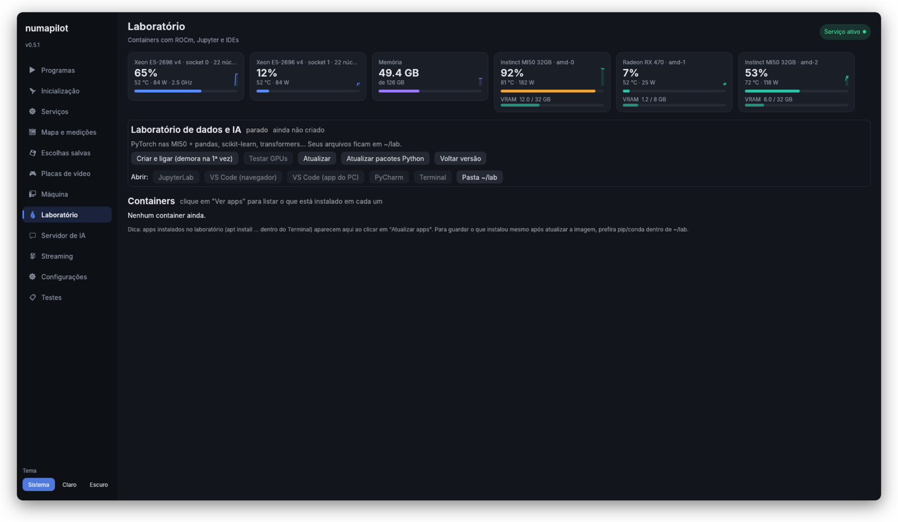
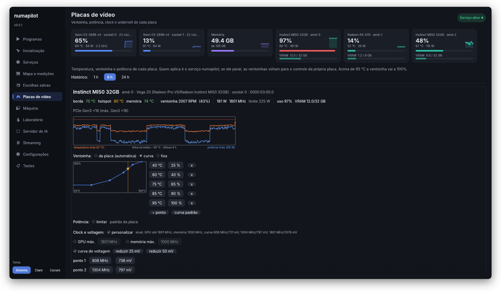
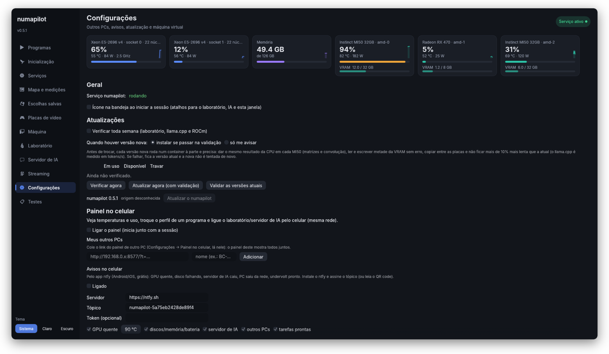
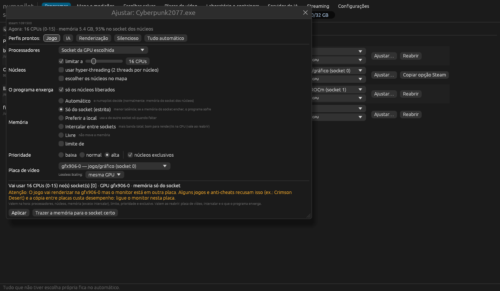
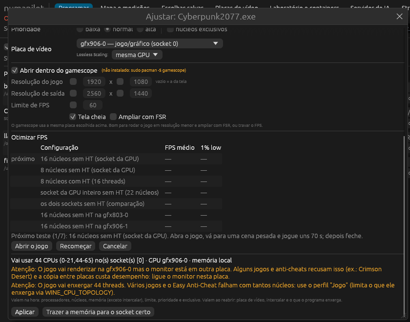
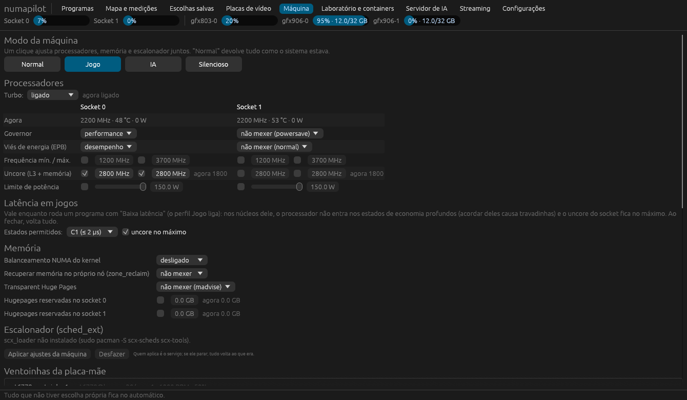
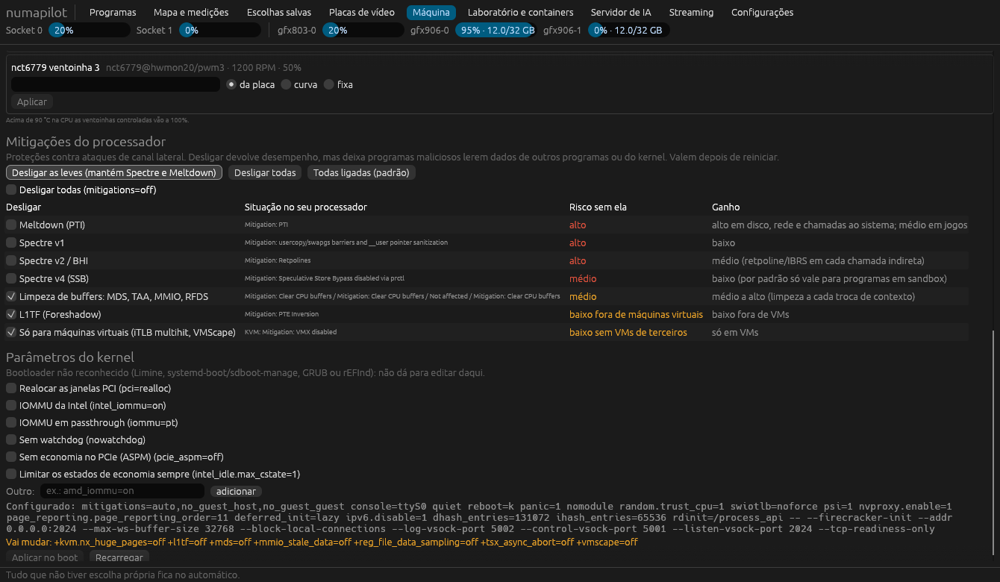
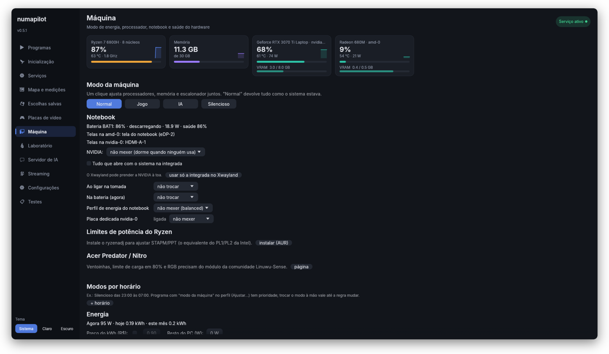
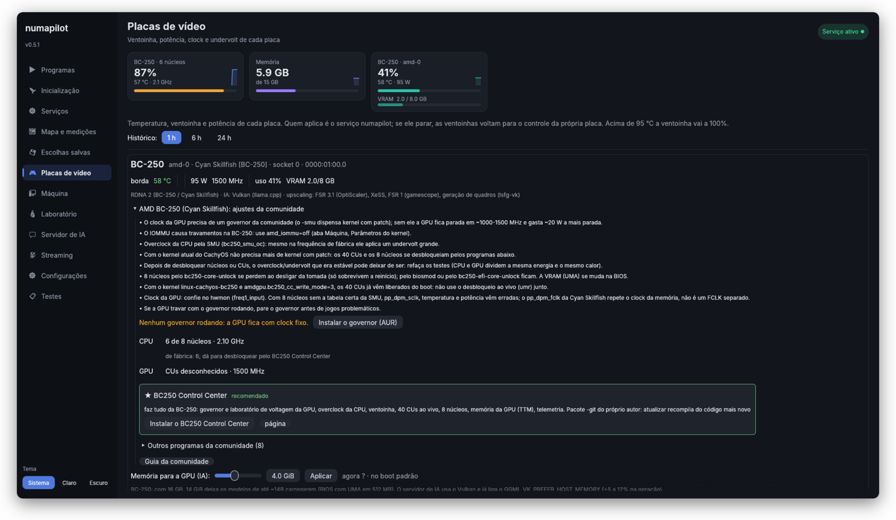

# numapilot

Escolhe **qual processador (socket NUMA), qual memória e qual GPU** cada programa usa,
em máquinas com 2 sockets. Feito para um servidor com 2× Xeon E5-2696 v4, 2× MI50 e 1× RX470
no CachyOS, mas funciona em qualquer Linux.

- **Automático (padrão):** um daemon observa os programas, coloca cada um no socket mais
  adequado e move a memória junto. Só usa os dois sockets quando o programa satura um deles.
- **Manual:** você decide o socket e a GPU, por comando (`numapilot run`) ou por regra no
  `/etc/numapilot.toml`.
- **Interface gráfica (`numapilot-gui`):** lista os programas abertos e deixa escolher, por
  programa, o processador e a placa de vídeo. O padrão é tudo no automático.
- **Controle fino por programa:** quantos e quais núcleos, com ou sem hyper-threading, um ou dois
  processadores, limite de memória, memória só do socket ou não, prioridade, núcleos exclusivos e
  quantos núcleos o programa "enxerga". Tem perfis prontos (Jogo, IA, Renderização, Silencioso).
- **Mapa e medições:** os núcleos de cada socket com o uso e quem está em cada um, a memória de cada
  programa (% local), alocações no outro socket e a latência/banda medidas entre os sockets.
- **Placas de vídeo:** temperaturas, curva da ventoinha e limite de potência de cada MI50.
- **Laboratório e containers:** Jupyter, VS Code e PyCharm com PyTorch nas MI50, abertos por um
  clique; lista os containers e os apps instalados em cada um.
- **Servidor de IA:** llama.cpp nas MI50 com API compatível com a da OpenAI.
- **Streaming:** liga o Sunshine e escolhe qual GPU codifica o vídeo.
- **Ícone na bandeja** com as temperaturas e atalhos, e **atualização semanal automática** que testa
  nas GPUs e volta sozinha se algo quebrar.
- **gfx906-rocm:** instala, atualiza, testa e faz rollback dos ROCm da comunidade para as MI50,
  sem mexer no ROCm do sistema.
- **Diagnóstico (`numapilot doctor`):** testa cada parte no seu hardware e diz o que corrigir; gera um
  relatório para enviar.
- **Steam com um clique:** coloca o numapilot nas opções de inicialização de todos os jogos.
- **Otimizador de FPS:** testa configurações num jogo (medindo com o MangoHud) e escolhe a melhor.
- **Painel no celular**, **undervolt/overclock das MI50**, gráficos de temperatura e alertas, e
  **gamescope por jogo**.
- **Máquina:** modos de um clique (Jogo, IA, Silencioso, Normal); governor, viés de energia,
  frequências, uncore e limite de potência por socket; latência baixa só enquanto o jogo roda;
  memória (balanceamento NUMA, THP, hugepages); escalonador sched_ext; ventoinhas da placa-mãe;
  mitigações do processador uma a uma; parâmetros do kernel sem editar o bootloader à mão.


## 1. Antes de tudo: BIOS

Na BIOS, **NUMA ligado / "Node Interleaving" desligado**. Se o `numapilot topo` mostrar só
1 nó com 2 sockets, ele avisa. Se alguma GPU aparecer com `nó ?`, defina o socket dela em
`[gpu_node]` no config.

## 2. Instalar

```bash
git clone <este repositório> numapilot && cd numapilot
./install.sh          # confere o sistema, instala o que falta, compila, ativa o serviço e roda o diagnóstico
```

O instalador primeiro confere tudo: pacotes obrigatórios (Rust, bibliotecas da interface, polkit...),
opcionais com a explicação de cada um (podman, MangoHud, gamescope, scx, lm_sensors, vulkan-tools...),
cgroups v2, nós NUMA, driver amdgpu, `/dev/kfd`, se você está nos grupos `render` e `video` e o
módulo do uncore. Depois instala o que falta pelo pacman (os opcionais ele pergunta), compila,
ativa o serviço e termina com o `numapilot doctor`.

| Comando | O que faz |
|---|---|
| `./install.sh --check` | só mostra o que falta, sem mudar nada |
| `./install.sh --yes` | instala tudo sem perguntar |
| `./install.sh --minimal` | só o obrigatório |
| `./install.sh --restore ARQUIVO` | instala e restaura as configurações de um backup |

**Antes de formatar:** `numapilot backup` (ou Configurações → Fazer backup) salva num `.tar.gz`
os perfis dos programas, os ajustes da máquina, das ventoinhas e das GPUs (inclusive undervolt),
o OverDrive, os parâmetros do kernel que o numapilot controla, o laboratório e o servidor de IA, o
otimizador de FPS, os atalhos do menu e a atualização semanal. Guarde o arquivo fora do disco do
sistema. Depois de reinstalar: `./install.sh --restore numapilot-backup-DATA.tar.gz` (se o arquivo
estiver na sua pasta pessoal, o instalador acha sozinho e pergunta). Os modelos `.gguf` e a pasta
`~/lab` são seus dados: copie à parte.

Para remover: `./uninstall.sh`. Roteiro de testes no hardware: [docs/TESTES.md](docs/TESTES.md).

**Pelo pacman (Arch/CachyOS):** o `packaging/arch/PKGBUILD` gera o pacote `numapilot-git` a partir
deste repositório, com o binário em `/usr/bin` e o serviço em `/usr/lib/systemd/system`:

```bash
cd packaging/arch && makepkg -si
sudo systemctl enable --now numapilot
```

Versão estável: `packaging/arch/release/PKGBUILD` (pacote `numapilot`, a partir das tags `vX.Y.Z`).

**Binários prontos:** cada tag `v*` gera uma release no GitHub com
`numapilot-X.Y.Z-x86_64-linux.tar.gz`. Extraia e rode `./install.sh` (ele detecta os binários
prontos e pula a compilação).

**CI:** cada push roda testes, clippy, compilação sem interface e shellcheck
(`.github/workflows/ci.yml`). **AUR:** o workflow de release publica o pacote `numapilot` no AUR se
existir o segredo `AUR_SSH_KEY` (chave SSH cadastrada na sua conta do AUR). O AUR baixa o código do
GitHub, então o repositório precisa estar público para isso.

Depois de instalar, rode **`numapilot doctor`** (ou Configurações → Verificar tudo).

### Vários PCs no mesmo código

O numapilot roda em vários PCs (servidor, notebook, BC-250, CC150...). A regra é **uma versão só**:
a `main` do GitHub é a referência, e a pasta local de cada PC e o programa instalado ficam
sempre iguais a ela.

**PC novo:**

```bash
sudo pacman -S --needed rust git                # num terminal normal (Konsole)
mkdir -p ~/Projetos && cd ~/Projetos
git clone https://github.com/lucasfracaro/numapilot && cd numapilot
./install.sh                                    # pede a senha
numapilot autoteste                             # confere tudo nesta máquina
```

Rode o `install.sh` e o `self-update run` num **terminal normal**. Terminais dentro de outros
programas (como o do Claude Code) podem bloquear o `sudo` com a mensagem "sem novos privilégios".

Para só usar, o clone acima basta. Para enviar mudanças (push) desse PC: `sudo pacman -S github-cli` e
`gh auth login`.

**Antes de mexer no código, em qualquer PC:** `git pull --ff-only`.

**Depois de mexer:** rode o mesmo que a CI, depois commit e push na hora. Não deixe commit só local,
porque os outros PCs não o recebem.

```bash
cargo fmt --check && cargo test --release \
  && cargo clippy --release --all-targets -- -D clippy::correctness -D clippy::suspicious \
  && cargo build --release --no-default-features
shellcheck -S warning install.sh uninstall.sh packaging/gfx906-rocm container/lab-start packaging/arch/numapilot.install
git pull --rebase && git push
```

**Atualizar cada PC:**

```bash
numapilot self-update        # mostra o commit instalado, o que falta da pasta e do GitHub
numapilot self-update run    # git pull + ./install.sh --yes (pede a senha)
numapilot autoteste          # confirma que nada quebrou nesta máquina
```

**Para não quebrar os outros PCs:** cada recurso depende do hardware detectado (processador,
GPU, notebook, placa especial) e, quando o hardware não existe, só aparece como "pulou" ou "info".
Os testes usam um sysfs falso (`NUMAPILOT_SYSFS`) com várias máquinas simuladas. Uma correção
feita num PC entra para todos no próximo `self-update run`, então vale rodar o `autoteste` nos
outros PCs depois de atualizar.

## 3. Modo automático (o daemon)

Ele já fica rodando depois do `install.sh`. Para cada programa de usuário:

| Situação | O que o daemon faz |
|---|---|
| O programa casa com uma regra do config | Aplica a regra na hora (antes de alocar muita memória) |
| É filho de um programa com regra (ex.: jogo aberto pela Steam) | Herda a decisão |
| Abre uma GPU (`/dev/dri/renderD*`) | Vai para o **socket ligado àquela GPU** |
| Usa CPU (≥ 0,5 núcleo por 3 s) sem GPU | Vai para o **socket menos ocupado** com RAM livre |
| Usa ≥ 85% dos CPUs do socket por 10 s | **Expande para os 2 sockets** e grava isso |
| Expandido, mas usando < 30% de um socket por 2 min | Volta para 1 socket |
| Já foi visto antes | Começa direto no lugar aprendido (2 sockets, ou o socket da GPU dele) |

O daemon não mexe em processos do sistema, em programas abertos com `numapilot run` no modo
manual, em programas fixados com `numapilot pin`, nem em quem já definiu a própria afinidade
(ex.: `taskset`). Ao parar o serviço, ele devolve todos os CPUs para os processos que moveu.

```bash
numapilot status                  # o que está sendo gerenciado agora
numapilot learned                 # o que ele aprendeu
sudo numapilot learned --forget blender
journalctl -u numapilot -f        # decisões em tempo real
```

## 4. Interface gráfica

Abra **numapilot** no menu (ou `numapilot-gui`). O daemon em segundo plano mapeia cada programa
aberto, e ele aparece na lista agrupado por programa. Os jogos da Steam são agrupados pelo AppId.

A aba **Programas** é uma tabela no estilo de um monitor do sistema:

- colunas **Nome, PID, CPU, Memória, GPU, Memória da GPU e Placa**, com o total de cada uma no
  cabeçalho. Clique no título para ordenar (de novo inverte a ordem). A CPU é a % da máquina
  toda. A memória é o PSS (a memória dividida entre processos conta uma vez só). GPU e memória
  da GPU vêm do `fdinfo` do DRM de cada processo (amdgpu, Intel e NVIDIA com driver novo);
- duas seções: **Aplicativos** e **Sessão e sistema** (KDE/GNOME, Xwayland, áudio, portais...);
- a seta (ou dois cliques) abre a linha: processos do programa e os controles abaixo;
- **Encerrar** (SIGTERM, como fechar a janela) e **Forçar parada** (SIGKILL, pede confirmação)
  no programa selecionado. Só valem para programas seus abertos na sessão (`app.slice`). Nunca
  valem para o kernel, o sistema, outros usuários, a sessão gráfica (`session.slice`, kwin,
  plasmashell...) nem o próprio numapilot. Lista em `src/procctl.rs`;
- **Buscar** por nome, executável ou PID, e **Só os meus**.

- **Processador:** Automático, Socket da GPU escolhida, Só o socket 0/1 ou Os dois sockets.
  A troca vale **na hora**: o processo e a memória dele mudam de socket.
- **Placa de vídeo:** Automático, a placa de vídeo, cada MI50 como **jogo/gráfico** ou
  **IA/ROCm**, ou Nenhuma. A GPU só pode ser escolhida quando o programa abre, então a escolha
  fica salva e vale na próxima abertura. Para valer sem digitar comandos:
  - programas comuns: **Reabrir** (fecha e abre já na GPU nova) ou **Usar no menu**. Esse botão
    cria uma cópia do atalho em `~/.local/share/applications` que abre o programa pelo numapilot.
  - jogos da Steam: **Copiar opção Steam** e cole `numapilot run -- %command%` em
    Propriedades → Opções de inicialização. É uma vez por jogo; depois, a GPU escolhida na interface vale sempre.
- **Lossless Scaling:** em qual GPU o lsfg-vk gera os quadros (veja a seção 6).
- A aba **Escolhas salvas** mostra o que não está no automático e permite voltar ao automático.

As escolhas ficam em `/var/lib/numapilot/profiles.json`. Na linha de comando, use
`numapilot profile list|set|rm`.

**Outras abas:**

| Aba | O que faz |
|---|---|
| Mapa e medições | núcleos de cada socket (uso, programas presos a cada um), memória por socket, alocações no outro socket, governador de frequência por socket, latência e banda medidas |
| Placas de vídeo | temperaturas (borda/hotspot/memória), ventoinha automática, por curva ou fixa, e limite de potência |
| Laboratório e containers | liga/atualiza o laboratório; abre JupyterLab, VS Code (navegador ou app do PC), PyCharm e terminal; lista os containers e os apps de cada um |
| Servidor de IA | escolhe o modelo `.gguf`, as MI50 e o contexto; inicia/para; abre o chat e mostra o endereço da API |
| Streaming | liga o Sunshine e escolhe a GPU que codifica o vídeo (mostra quem faz H.264/HEVC/AV1) |
| Configurações | ícone na bandeja ao iniciar a sessão, atualização semanal, hardware detectado |

Comandos demorados (ligar o laboratório, atualizar...) rodam em segundo plano, numa janela com a
saída ao vivo. A interface continua usável enquanto isso.



## 5. Escolher GPU e socket ao abrir um programa (linha de comando)

A GPU só pode ser escolhida **quando o programa abre** (por variáveis de ambiente), por isso
existe o `numapilot run`. Sem opções, ele decide sozinho:

```bash
numapilot run -- blender                    # automático
numapilot run -n -- llama-server -m x.gguf  # -n: só mostra o que faria, e por quê
```

Manual:

```bash
numapilot run --gpu display --cpu gpu -- ./jogo        # RX470 + o socket dela
numapilot run --gpu gfx906-1 --use graphics -- %command% # jogo renderizado numa MI50
numapilot run --gpu gfx906-1 -- llama-server ...        # MI50 específica (socket dela)
numapilot run --gpu compute:all --cpu all -- python treino.py   # as 2 MI50 + 2 sockets
numapilot run --cpu 0 --gpu none -- ffmpeg ...           # só o socket 0
numapilot run --cpu all --mem interleave -- ./banco-de-dados
```

| Opção | Valores |
|---|---|
| `--cpu` | `auto`, `all`, `gpu` (socket da GPU), `0`, `1`, `0,1`, `cpus:0-21` |
| `--gpu` | `auto`, `display`, `compute`, `compute:2`, `compute:all`, `none`, apelido ou PCI |
| `--mem` | `local` (padrão), `interleave`, `bind` |
| `--use` | `auto`, `graphics` (jogo, inclusive numa MI50), `compute` (ROCm) |
| `--fg-gpu` | GPU do frame generation do Lossless Scaling (padrão: a mesma do jogo) |

No automático, a GPU de vídeo (com monitor) vai para programas gráficos. As MI50 vão para
programas de IA/computação conhecidos (`llama-*`, `ollama`, `comfyui`, `vllm`, `whisper*`...;
lista em `compute_hints`), sempre a **menos ocupada** (uso + VRAM). O socket é o da GPU escolhida.

O que ele configura: `DRI_PRIME=pci-...` para OpenGL/Vulkan (o `MESA_VK_DEVICE_SELECT` só é usado
quando o ID da placa é único; as duas MI50 têm o mesmo ID), `LSFGVK_GPU` para o Lossless Scaling, e
`ROCR_VISIBLE_DEVICES` (UUID da MI50, que esconde a RX470 do ROCm) para ROCm/HIP. Também exporta
`NUMAPILOT_CPUS`, `NUMAPILOT_MEMS` e `NUMAPILOT_RENDER` para scripts e containers.

**Steam:** nas opções de inicialização do jogo, use `numapilot run --gpu display -- %command%`.
A regra `jogos` do config já cobre a Steam inteira pelo daemon.

Para um processo que já está rodando: `sudo numapilot pin <pid> --cpu 1` (move os CPUs e a RAM).

## 6. Jogos nas MI50 e Lossless Scaling

**Jogar numa MI50:** escolha "gfx906-N — jogo/gráfico" na interface, ou `--use graphics`.
- Com o monitor ligado na própria MI50, ela renderiza e exibe direto. O numapilot reconhece a
  placa como MI50 mesmo com monitor ligado.
- Com o monitor na RX470, a MI50 renderiza e cada quadro é copiado para a RX470 (PRIME
  offload). Nesse caso, prefira a MI50 do mesmo socket da RX470.
- Para o automático mandar todos os jogos para uma MI50, defina `graphics_gpu = "gfx906-1"` no config.

**Lossless Scaling no Linux (lsfg-vk):**
- O lsfg-vk oficial gera os quadros **na mesma GPU do jogo**. Dual GPU ainda não é suportado,
  e o numapilot já aponta o `LSFGVK_GPU` para a GPU do jogo.
- Para dual GPU (jogo numa MI50, frame generation na outra, com o monitor ligado nela), é
  preciso um fork do lsfg-vk com essa função. Em "Lossless Scaling" na interface (ou
  `--fg-gpu`), escolha a outra GPU: o numapilot exporta `LSFGVK_GPU` com ela. Isso é
  experimental e depende do fork respeitar essa variável.

## 7. Regras manuais permanentes

Edite `/etc/numapilot.toml` (exemplo comentado incluído) e rode `sudo systemctl restart numapilot`:

```toml
[aliases]
"0000:03:00.0" = "rx470"
"0000:04:00.0" = "mi50a"

[[rule]]
name = "jogos"
match = ["steam", "*.exe", "gamescope"]
cpu = "gpu"        # socket da RX470
gpu = "display"
reserve = true     # o automático evita pôr outras cargas pesadas nesse socket
```

## 8. MI50 com o ROCm da comunidade (`gfx906-rocm`)

A AMD tirou a gfx906 dos builds oficiais, mas o compilador ainda suporta ela. Existem dois caminhos
mantidos pela comunidade, e o script cuida dos dois:

### a) Container: o mais fácil de manter

Usa a imagem do projeto **mixa3607/ML-gfx906** (ROCm 10.1 para gfx906, compilado via TheRock; 7.14 e 10.0 também existem: troque `IMAGE` no config).
Isso não depende das bibliotecas do CachyOS. O host só precisa do driver `amdgpu`, que já vem no kernel.

```bash
sudo pacman -S podman
gfx906-rocm container pull                       # atualizar = rodar de novo / trocar a tag
numapilot run --gpu gfx906-1 -- gfx906-rocm container run -- rocminfo
```

O container recebe só a(s) MI50 escolhida(s) pelo numapilot (`NUMAPILOT_RENDER`) e os CPUs do
socket dela. O mesmo projeto também tem imagens prontas de PyTorch, ComfyUI e llama.cpp.

### b) Nativo (tarball lado a lado)

Cada versão fica em `/opt/rocm-gfx906/<versão>`. `current` aponta para a ativa e `previous` para
a anterior. Nada vai para o PATH global, então não briga com o ROCm do pacman.

```bash
sudo gfx906-rocm update --check   # há versão nova?
sudo gfx906-rocm update           # baixa, testa nas MI50 e só ativa se passar
gfx906-rocm list
sudo gfx906-rocm rollback         # voltou algo quebrado? volta para a anterior
sudo gfx906-rocm prune 2          # limpa as antigas
gfx906-rocm doctor                # driver, /dev/kfd, grupos, GPUs, conflitos

# usar
numapilot run --gpu compute -- gfx906-rocm exec -- llama-server -m modelo.gguf -ngl 99
eval "$(gfx906-rocm env)"         # ou carregar no shell atual
```

O `update` procura, por padrão, os tarballs noturnos do TheRock com `gfx906` no nome
(`INDEX_URL`/`FILTER` em `/etc/gfx906-rocm.conf`). Também dá para instalar qualquer tarball
(ex.: um build seu ou de outro mantenedor): `sudo gfx906-rocm install <url-ou-arquivo> [nome]`.
O teste roda `rocminfo` e compila e executa um kernel HIP em cada MI50. Se falhar, a versão nova
fica instalada, mas **não é ativada**.

Para manutenção automática, crie um timer do systemd que rode `gfx906-rocm update` uma vez por
semana. Como ele só ativa versões que passam no teste, é seguro.

Dicas da comunidade para gfx906:

- Compile seus programas com `--offload-arch=gfx906` (ou `AMDGPU_TARGETS=gfx906`).
- Builds antigos do ROCm 6.x precisavam de `HSA_OVERRIDE_GFX_VERSION=9.0.6`. Os builds próprios
  para gfx906 não precisam.
- Usuário nos grupos `render` e `video` (o `doctor` verifica).

## 9. Laboratório de ciência de dados e ML nas MI50 (`gfx906-rocm lab`)

Um container com tudo pronto para usar as MI50. É construído sobre o PyTorch compilado para gfx906
pela comunidade (mixa3607/ML-gfx906) e ganha:

- **Dados/ciência:** numpy, scipy, pandas, polars, pyarrow, duckdb, numba, scikit-learn,
  scikit-image, statsmodels, sympy, networkx
- **Visualização:** matplotlib, seaborn, plotly, altair, ipywidgets
- **ML clássico:** xgboost, lightgbm, catboost, optuna, shap, mlflow, tensorboard. Esses rodam na
  CPU, que aqui são 88 threads; o PyPI não tem builds deles para ROCm.
- **Deep learning (na GPU, via PyTorch):** transformers, datasets, accelerate, peft, lightning,
  torchmetrics, timm, kornia
- **Ferramentas:** JupyterLab, VS Code no navegador (code-server, com as extensões Python e Jupyter),
  SSH, ruff, pytest, nvtop, git, opcionalmente o PyCharm

O PyTorch gfx906 da imagem fica **travado** no build: nenhum pacote pode trocá-lo por um build CUDA do PyPI.

```bash
sudo pacman -S podman          # recomendado (sem root); docker também funciona
gfx906-rocm lab up             # constrói na 1ª vez (a base tem vários GB) e sobe
gfx906-rocm lab                # mostra os endereços, o token e a senha
gfx906-rocm lab test           # PyTorch enxerga as MI50? faz conta em cada uma?
gfx906-rocm lab shell          # terminal dentro do container
gfx906-rocm lab down
```

| Serviço | Endereço |
|---|---|
| JupyterLab | `http://127.0.0.1:8888/lab?token=...` |
| VS Code (navegador) | `http://127.0.0.1:8443` (a senha é o mesmo token) |
| SSH | `ssh -p 2222 root@127.0.0.1` (usa as suas chaves de `~/.ssh`) |

Os projetos ficam em `~/lab` (no container: `/workspace`). Os modelos baixados ficam no cache do
Hugging Face do host (`~/.cache/huggingface`), então não são baixados de novo.

**Editores no host:**
- **VS Code (desktop):** use a extensão *Remote - SSH* com `Host gfx906-lab`, `HostName 127.0.0.1`,
  `Port 2222`, `User root`. Outra opção é *Dev Containers → Attach to Running Container*; com podman,
  configure `"dev.containers.dockerPath": "podman"`.
- **PyCharm:** o interpretador remoto por SSH (`/usr/bin/python3` em `127.0.0.1:2222`) é recurso da
  versão paga. Sem ela, defina `LAB_PYCHARM=1` em `/etc/gfx906-rocm.conf`, rode `gfx906-rocm lab build`
  e depois `gfx906-rocm lab pycharm`: o PyCharm roda **dentro** do container e a janela abre na sua tela.

**Atualizar com segurança:**

```bash
gfx906-rocm lab update --check   # há base nova (PyTorch/ROCm)?
gfx906-rocm lab update           # reconstrói, testa nas GPUs e volta sozinho se falhar
gfx906-rocm lab update --force   # mesma base, mas atualiza todos os pacotes Python
gfx906-rocm lab rollback         # volta para a imagem anterior
```

Por padrão, o update usa sempre a tag mais nova (`vX.Y.Z-rocm-A.B`). Para ficar numa versão,
defina `LAB_BASE` no config. Há relatos de falha em multi-GPU com ROCm novo em algumas máquinas
(issue #28 do ML-gfx906). Se acontecer, fixe uma base 7.2.x.

**Com o numapilot:** para dedicar uma MI50 ao laboratório e deixar a outra livre para jogos, use
`numapilot run --gpu gfx906-1 --use compute -- gfx906-rocm lab up`. O container recebe só aquela
GPU e os CPUs do socket dela.

Para acessar de outro computador da rede, use `LAB_BIND="0.0.0.0"`. O acesso continua protegido por
token, senha e chave SSH.

## 10. Ventoinha e potência das MI50

Na aba **Placas de vídeo**, cada placa tem três modos de ventoinha: o automático da própria placa,
uma **curva** (temperatura do hotspot → %) ou uma velocidade **fixa**. Também dá para limitar a
**potência** em W, dentro do mínimo e do máximo da placa.

- Quem aplica é o serviço numapilot. As escolhas ficam em `/var/lib/numapilot/gpu.json` e voltam
  sozinhas depois de reiniciar.
- Segurança: a 95 °C a ventoinha vai a 100%, qualquer que seja o modo. Se o serviço parar, as
  ventoinhas voltam para o controle da placa.
- Algumas VBIOS não expõem o controle da ventoinha. Nesse caso, a interface avisa.
- **Histórico:** gráfico de temperatura e potência de cada placa (1 h, 6 h ou 24 h), gravado pelo
  serviço a cada 30 s.
- **Clock e voltagem (undervolt/overclock):** clock máximo da GPU e da memória e os 3 pontos da curva
  de voltagem. Os botões "reduzir 25 mV / 50 mV" fazem um undervolt a partir da curva atual (menos
  calor e consumo, mesmo clock). O serviço reaplica ao reiniciar; desmarcar "personalizar" volta ao
  padrão de fábrica. Se travar, volte um passo.
- **Ativar o OverDrive** (necessário para clock/voltagem): botão na própria aba, ou Configurações →
  Opções de boot, ou `sudo numapilot boot overdrive on`. Ele não mexe no bootloader: grava
  `options amdgpu ppfeaturemask=...` em `/etc/modprobe.d/numapilot.conf` (o valor atual do driver
  com só o bit do OverDrive ligado) e refaz a imagem de boot com a ferramenta da distro
  (`limine-mkinitcpio`, `mkinitcpio -P`, `dracut` ou `update-initramfs`). Como o arquivo vale para
  qualquer kernel, as atualizações do kernel mantêm a opção. Depois é só reiniciar.
- **Resizable BAR:** a aba mostra se está ativo (VRAM inteira visível pela CPU). O diagnóstico diz o
  que tentar na BIOS.
- **Alerta:** o ícone na bandeja manda uma notificação quando uma GPU passa de 90 °C por ~15 s.



## 11. Servidor de IA (`gfx906-rocm llm`)

Roda o llama.cpp compilado para gfx906 (builds diárias do mixa3607/ML-gfx906) num container, com
API compatível com a da OpenAI. Funciona com Open WebUI, Continue, LibreChat e scripts.

```bash
mkdir -p ~/models   # coloque os .gguf aqui
gfx906-rocm llm models
gfx906-rocm llm up Qwen3-32B-Q4_K_M.gguf   # ou escolha pela interface
gfx906-rocm llm                            # endereço do chat e da API
gfx906-rocm llm update                     # build nova do llama.cpp (volta se falhar)
```

- Padrão: as duas MI50, com o modelo dividido por camadas. Para usar só uma, escolha `gfx906-0` ou
  `gfx906-1` na interface ou em `LLM_GPU`.
- Ele passa pelo numapilot: o container recebe só as GPUs escolhidas e os processadores e a memória
  do socket delas.
- Os ajustes da interface ficam em `~/.config/gfx906-lab/settings.env`.

## 12. Atualizações do ROCm sem quebrar, e ícone na bandeja

O ROCm das MI50 vem da comunidade (mixa3607/ML-gfx906 e os tarballs do TheRock), que publica
versões novas com frequência. Para saber **quando** atualizar e garantir que **não quebra**:

- **Quando:** `gfx906-rocm check` (ou Configurações → Verificar agora) compara o que está em uso
  com o que saiu, para o laboratório, o llama.cpp, a imagem ROCm e o ROCm nativo, sem mudar nada.
  A verificação semanal (`gfx906-rocm autoupdate enable`, ou o checkbox em Configurações) faz isso
  sozinha. Em "só me avisar" ela só manda uma notificação; em "instalar se passar na validação"
  ela já atualiza.
- **Sem quebrar:** cada versão nova é baixada ou construída **ao lado** da atual e validada num
  container à parte, nas MI50, antes de trocar. A versão em uso continua rodando enquanto isso.
  - PyTorch: em cada placa, matriz e convolução com o mesmo resultado que a CPU; metade da VRAM
    escrita e lida sem erro; desempenho fp16; cópia entre as duas placas.
  - llama.cpp: tokens/s com o menor modelo da pasta (`llama-bench`), ou, sem modelo, se enxerga as
    gfx906.
  - Imagem ROCm: `rocminfo` e um kernel HIP compilado e executado em cada placa.
  - Desempenho comparado com a versão atual: mais de `REGRESS_PCT`% (padrão 10%) mais lenta é
    recusada.
  Se falhar, fica a versão atual, a nova não é tentada de novo e o motivo vai para o histórico.
- **Travar:** `gfx906-rocm hold lab|llm|image|rocm` (ou a coluna "Travar" em Configurações) segura um
  componente na versão atual, por exemplo durante um trabalho importante.
- **Histórico:** `gfx906-rocm history` mostra cada atualização com o resultado e o desempenho.
  `gfx906-rocm validate` mede as versões atuais e grava como referência.


- O **ícone na bandeja** (`numapilot-gui --tray`, ou ative em Configurações) mostra a temperatura,
  o uso e a potência de cada GPU. Fica de outra cor acima de 90 °C. O menu dá acesso ao JupyterLab,
  ao VS Code, ao PyCharm, ao terminal do laboratório, ao chat do servidor de IA e ao painel do Sunshine.
- Para os containers voltarem depois de reiniciar o PC, o podman sem root usa o
  `podman-restart.service` do usuário, que é ativado automaticamente. Para eles subirem mesmo sem
  você fazer login: `sudo loginctl enable-linger $USER`.

## 13. Detecção instantânea

Como root, o daemon recebe do kernel um aviso a cada programa aberto (netlink "proc connector").
Assim, a regra, o perfil ou o aprendizado é aplicado logo após o programa iniciar, antes de ele
alocar memória, e a memória já nasce no socket certo. Sem essa permissão, ele volta para a
verificação a cada segundo.

## 14. Controle fino por programa (botão "Ajustar…")

Em **Programas** (ou em **Escolhas salvas**), o botão **Ajustar…** abre o editor do programa:

| Opção | O que faz | Quando vale |
|---|---|---|
| Processadores | socket 0, socket 1, os dois ou o socket da GPU | na hora |
| Núcleos | limitar a N CPUs, com ou sem hyper-threading, ou escolher no mapa (clique = núcleo inteiro; botão direito = 1 thread) | na hora |
| O programa enxerga | só os núcleos liberados: `WINE_CPU_TOPOLOGY` (Proton), `OMP/MKL/OPENBLAS/RAYON_NUM_THREADS`, `GOMAXPROCS`, .NET e Java | ao abrir |
| Memória | automático, **só do socket** (estrito, menor latência), preferir a local, intercalar (mais banda) ou livre | na hora (intercalar: ao abrir) |
| Limite de memória | teto em GB (cgroup `MemoryMax`) | na hora |
| Prioridade | baixa, normal ou alta (CPU e disco) | na hora |
| Núcleos exclusivos | o resto do sistema deixa de usar esses núcleos enquanto o programa roda | na hora |
| Placa de vídeo | GPU e uso (jogo/IA) e GPU do Lossless Scaling | ao abrir |

Embaixo, uma prévia mostra exatamente o que vai acontecer ("Vai usar 16 CPUs (0-15) no socket 0 ·
GPU gfx906-0 · memória só do socket"), com avisos de compatibilidade.

**Como funciona:** os limites de memória, a memória estrita e os núcleos exclusivos usam um grupo de
controle (cgroup v2) por programa, criado pelo próprio systemd em `numapilot.slice`. Assim o
numapilot não briga com o systemd e os processos filhos herdam tudo. Para núcleos exclusivos, o
`user.slice` e o `system.slice` deixam de usar esses núcleos enquanto o programa roda. Se o serviço
parar, tudo volta ao normal.



## 15. Jogos em servidor com 2 processadores (DirectX e Vulkan)

Os problemas típicos desse tipo de máquina, e o que o perfil **Jogo** faz:

| Problema | Causa | O que o numapilot faz |
|---|---|---|
| Jogo não abre ou o Easy Anti-Cheat bloqueia | o jogo enxerga 88 threads; vários jogos e anti-cheats quebram acima de ~32 | `WINE_CPU_TOPOLOGY` faz o jogo do Proton enxergar só os núcleos liberados (o `taskset` sozinho não muda isso) |
| FPS muito baixo (ex.: 20 em vez de 60) | threads e memória espalhados pelos 2 sockets: cada acesso remoto custa ~50% a mais | 1 socket só (o da GPU), núcleos físicos sem HT, memória só local, prioridade alta e núcleos reservados |
| Jogo recusa abrir renderizando numa placa e exibindo em outra | a placa do jogo não tem o monitor (PRIME) ou está no outro socket | o jogo só enxerga a GPU escolhida e um aviso pede para ligar o monitor nela |

**DirectX e Vulkan:** no Linux, jogos DirectX rodam pelo Proton, que traduz para Vulkan: o DXVK
cuida do DirectX 9/10/11 e o VKD3D-Proton do DirectX 12. Então tudo que vale para Vulkan vale para
os dois.
- O numapilot define `DRI_PRIME=pci-...` e `MESA_VK_DEVICE_SELECT_FORCE_DEFAULT_DEVICE=1`. Com isso,
  o jogo enxerga **só** a GPU escolhida e não escolhe sozinho outra placa (ex.: a outra MI50, com
  mais VRAM).
- Jogos OpenGL (e DirectX antigo pelo WineD3D) seguem o `DRI_PRIME`.
- A parte de processador e memória vale para qualquer programa, independente da API gráfica.

Receita para um jogo exigente (ex.: Elden Ring):
1. Ligue o monitor na MI50 que vai rodar o jogo, ou use a RX470 se for o caso.
2. Em **Ajustar…**, clique em **Jogo** e escolha essa placa como "jogo/gráfico".
3. Em **Programas → Steam: Aplicar em todos os jogos** (com a Steam fechada), ou cole
   `numapilot run -- %command%` nas opções de inicialização de um jogo.
4. Em **Mapa e medições**, coloque o socket da placa em `performance`.
5. Opcional: **Otimizar FPS** (seção 17) para achar a melhor combinação nesse jogo.

### Steam em todos os jogos

`numapilot steam enable` (ou o botão em **Programas**) coloca `numapilot run --` antes do
`%command%` de todos os jogos instalados, mantendo o que já existia (ex.: `PROTON_LOG=1 %command%
-dx12` vira `PROTON_LOG=1 numapilot run -- %command% -dx12`). Edita o `localconfig.vdf` da Steam,
que precisa estar fechada, e guarda um backup ao lado. `numapilot steam disable` desfaz e
`numapilot steam list` mostra quais jogos já estão com o numapilot.

### gamescope por jogo

No **Ajustar…**, "Abrir dentro do gamescope" com resolução do jogo, resolução de saída, limite de FPS,
tela cheia e FSR. O `numapilot run` monta `gamescope … -- jogo` na mesma GPU escolhida.

## 16. Medições

- `numapilot bench`, ou o botão **Medir agora** em Mapa e medições, mede a latência (pointer
  chasing) e a banda de leitura de cada socket lendo a memória dele mesmo e a do outro.
- A coluna de memória em **Programas** mostra quanto cada programa usa e quanto está no socket dos
  núcleos dele (lido do `numa_maps`). Abaixo de 80% aparece em laranja, com o botão **corrigir**.
- Em Mapa e medições, "alocações no outro socket" vem do `numastat` e mostra páginas criadas longe
  de quem pediu.

## 17. Otimizador de FPS

No **Ajustar…** de um jogo, **Otimizar FPS → Começar** cria uma lista de configurações para testar:
16, 8 e 8 com HT núcleos no socket da GPU, o socket inteiro, os dois sockets (para comparar) e as
outras placas. A cada vez que o jogo é aberto pelo numapilot, ele usa a próxima da lista e mede com o
MangoHud (`sudo pacman -S mangohud`): espera 10 s, grava 60 s do tempo de cada quadro e calcula o FPS
médio e o 1% low. Jogue sempre a mesma cena pesada. No fim, **Usar a melhor** salva a vencedora
(a nota valoriza mais o 1% low, que é o que se sente como travada).

Pela linha de comando: `numapilot tune start steam:1245620`, `numapilot tune status`,
`numapilot tune apply steam:1245620`.



## 18. Painel no celular

Configurações → **Painel no celular** liga o `numapilot web` (serviço do usuário
`numapilot-web.service`) e mostra um QR code. No celular, na mesma rede, aparecem as temperaturas,
o uso de cada socket e de cada GPU, os programas abertos com os perfis de um toque (Jogo, IA, Render,
Silencioso, Auto) e os atalhos do laboratório e do servidor de IA. O link leva um token (em
`~/.config/numapilot/web-token`); sem ele, nada é acessível. Para usar fora de casa, use uma VPN como
o Tailscale em vez de abrir a porta 8577 no roteador.

**Todos os PCs num painel só.** Com o numapilot instalado em cada máquina, copie o link do painel de
cada uma (o mesmo do QR code) e cole em Configurações → **Meus outros PCs** no PC principal, ou:

```sh
numapilot peers add "http://192.168.0.20:8577/?t=..." BC-250
numapilot peers list
numapilot peers remove BC-250
```

O painel do celular desse PC passa a mostrar a seção **Meus PCs**: para cada máquina, se está ligada,
a GPU mais quente, o uso dos processadores e um botão que abre o painel dela. A lista fica em
`~/.config/numapilot/peers.json` (só o seu usuário lê, porque guarda os tokens).

## 19. Diagnóstico

`numapilot doctor` testa no hardware real o que não dá para testar em outra máquina: NUMA, cgroups v2
e systemd, serviço e socket de controle, OverDrive, irqbalance, cada GPU (socket, monitor, ROCm,
ventoinha, potência, clock/voltagem, Resizable BAR, se só ela aparece no Vulkan com a seleção do
numapilot, OpenGL), grupos `render`/`video`, `/dev/kfd`, ferramentas e Steam. Para cada problema
mostra o comando que resolve.

`numapilot doctor --report` (ou Configurações → **Gerar relatório para enviar**) salva
`~/numapilot-relatorio.txt` com o diagnóstico e as informações do sistema (lscpu, numactl, lspci,
topologia, log do serviço, dispositivos Vulkan).

## 20. Máquina (processadores, memória, ventoinhas, boot)

A aba **Máquina** junta o controle do resto do hardware. Quem aplica é o serviço; se ele parar, tudo
volta ao que o sistema tinha quando ele iniciou.

- **Modos de um clique** (também `numapilot machine mode jogo|ia|silencioso|normal`):
  - *Jogo*: socket da placa de vídeo em `performance`, EPB desempenho, uncore no máximo, turbo,
    balanceamento NUMA do kernel desligado e escalonador LAVD em modo jogo (se o `scx_loader`
    estiver instalado).
  - *IA*: os dois sockets em `performance`, uncore no máximo, THP `always`.
  - *Silencioso*: sem turbo, governor econômico, EPB economia, potência de cada socket limitada a
    60% e LAVD em economia.
  - *Normal*: devolve tudo.
- **Por socket:** governor, viés de energia (EPB), frequência mínima e máxima, **uncore** (cache L3 e
  controlador de memória; mais alto = menos latência de memória; precisa do módulo
  `intel_uncore_frequency`) e **limite de potência** (RAPL), com consumo e temperatura ao vivo.
- **Latência em jogos:** programas com **Baixa latência** (o perfil Jogo liga; também no
  "Ajustar…") fazem os núcleos deles pararem de usar os estados de economia profundos (acordar deles
  causa travadinhas) e o uncore do socket ir ao máximo, só enquanto rodam. O resto da máquina
  continua economizando.
- **Perfil de energia da GPU por programa** (no "Ajustar…"): 3D tela cheia, computação, VR, vídeo
  ou economia, trocado sozinho quando o programa usa a placa. Jogo usa 3D; IA usa computação.
- **Memória:** balanceamento NUMA automático do kernel, `zone_reclaim`, Transparent Huge Pages e
  hugepages reservadas por socket (estas só servem para quem usa hugetlbfs, como máquinas virtuais;
  o llama.cpp e o PyTorch se beneficiam de THP e da memória no socket certo).
- **Escalonador sched_ext:** escolhe o escalonador e o modo pelo `scxctl` do CachyOS.
- **Ventoinhas da placa-mãe:** cada saída PWM do chip de sensores (nct67xx, it87...) em automático,
  curva (seguindo a CPU mais quente, uma CPU, as GPUs ou tudo) ou fixa; acima de 90 °C na CPU vão a
  100%. Em placas de servidor, as ventoinhas do IPMI aparecem e, em Supermicro, dá para escolher o
  modo do BMC.
- **Link PCIe** de cada GPU na aba Placas de vídeo e no diagnóstico (avisa se o slot está em x8).

### Mitigações do processador

Lista só as que afetam o seu processador (lidas de `/sys/devices/system/cpu/vulnerabilities`), com
o risco de desligar e o ganho típico. Botões prontos: **Desligar as leves (mantém Spectre e
Meltdown)**, **Desligar todas** (`mitigations=off`) e **Todas ligadas**. MDS, TAA, MMIO e RFDS
aparecem juntas porque usam a mesma limpeza de buffers: só há ganho desligando as quatro. Valem
depois de reiniciar.

### Parâmetros do kernel

O numapilot reconhece o bootloader (Limine em `/etc/default/limine`, systemd-boot pelo
`/etc/sdboot-manage.conf`, GRUB ou rEFInd), edita a linha dos parâmetros com backup e regrava as
entradas (`limine-mkinitcpio`, `sdboot-manage gen`, `grub-mkconfig`). Como é o arquivo que o
próprio sistema usa para gerar as entradas, as atualizações do kernel mantêm tudo. A entrada de
emergência (fallback) do Limine não é mexida. Pede a senha; pela linha de comando:
`sudo numapilot boot cmdline apply +pci=realloc -nowatchdog`.





## 21. Outros PCs: NVIDIA, notebook, Intel e um processador só

O mesmo programa serve para qualquer PC com CachyOS: ele descobre o hardware e mostra só o que
faz sentido. Num PC de um processador, o que é de dois sockets (memória do outro socket,
balanceamento NUMA) some.

**NVIDIA (driver oficial)**
- Na aba Placas de vídeo aparece o quadro **Driver NVIDIA**: qual série serve para a placa
  (GTX 16/RTX 20 em diante: série atual com os módulos abertos; Maxwell, Pascal e Volta: série
  580xx), o que está carregado, instalado e disponível, e os botões **Instalar driver oficial** e
  **Atualizar**. A instalação atualiza o sistema e usa o `chwd` do CachyOS (ou os pacotes certos
  para cada kernel instalado, removendo a outra série se for preciso). No CachyOS o driver é
  atualizado junto com o sistema: atualizar só ele quebraria as dependências. Pela linha de comando:
  `numapilot driver status`, `sudo numapilot driver install`, `sudo numapilot driver update`.
- Temperatura, consumo, uso e VRAM pelo `nvidia-smi`; limite de potência, **clock máximo
  travado** e **deslocamento da curva** clock/voltagem da GPU e da memória (pela NVML do próprio
  driver, sem X). Undervolt na NVIDIA = travar o clock (ex.: 1800 MHz) e deslocar a curva para cima
  (+100 a +200 MHz): o clock travado é alcançado com voltagem menor. O serviço reaplica quando a
  placa do notebook acorda.
- Escolher a NVIDIA para um programa usa o PRIME render offload oficial
  (`__NV_PRIME_RENDER_OFFLOAD`, `__GLX_VENDOR_LIBRARY_NAME`, `__VK_LAYER_NV_optimus`); escolher a
  outra placa num PC com NVIDIA esconde a NVIDIA. Para computação, `CUDA_VISIBLE_DEVICES`.

**Notebook**
- Jogos vão para a placa dedicada no automático (a integrada continua mostrando a imagem).
- Máquina → Notebook: bateria (carga, consumo, saúde), **modo automático na tomada e na bateria**
  (ex.: Jogo na tomada, Silencioso na bateria), **parar de carregar em 80%** quando o notebook
  permite, perfil de energia do fabricante (ACPI), deixar a placa dedicada **dormir** quando ninguém
  usa (o numapilot não acorda a placa para ler sensores), **quais programas estão mantendo a placa
  acordada** e o Dynamic Boost da NVIDIA.
- **Modo da NVIDIA, trocado com a sessão aberta** (Máquina → Notebook → NVIDIA, ou
  `numapilot hybrid auto|hibrido|integrada|nao-mexer`): mostra em qual placa está cada tela (no
  Nitro 5: a tela do notebook e o USB-C/Thunderbolt na 680M, o HDMI na NVIDIA).
  **Sempre disponível**: a placa fica no sistema, dorme quando ninguém usa e o HDMI funciona a
  qualquer hora. **Desligada**: o serviço tira a placa do sistema (zero consumo, nada a acorda); o KDE
  percebe e segue só na integrada, sem sair da sessão; o HDMI não funciona. **Automático**: na tomada
  disponível, na bateria desligada; tirar ou colocar o carregador troca na hora. Para devolver, o
  serviço lê o barramento PCI de novo e o KDE adiciona a placa sozinho. Só desliga se nenhum programa
  estiver usando a NVIDIA (senão espera, mostra quem é e a bandeja avisa); o `nvidia-powerd` para e
  volta junto. Ao parar o serviço, a placa sempre volta. Nada fica checando a placa periodicamente.
  Com o KDE, o KWin mantém aberta a saída de vídeo da NVIDIA; nessas condições o numapilot não tira
  a placa do sistema (o driver esperaria o desktop soltar) e ela simplesmente dorme sozinha quando
  nenhum programa a usa, com consumo praticamente zero. O diagnóstico separa quem só abriu a saída
  de vídeo (KWin, logind) de quem usa a placa de verdade e a mantém acordada (no Nitro 5 testado:
  LACT, Sunshine com NVENC, ZapZap), com a dica para cada um.
  **Tudo que abre com o sistema na integrada** (Máquina → Notebook, `numapilot autostart igpu`, e
  o instalador oferece): os atalhos da inicialização (~/.config/autostart e /etc/xdg/autostart, ex.:
  ZapZap, notificadores) e os serviços do usuário ligados no login (ex.: Sunshine) ganham as
  variáveis que fazem OpenGL/EGL/Vulkan usarem só a integrada; o Exec original fica guardado e
  `numapilot autostart normal` desfaz. Lançadores de jogos (Steam, Heroic, Lutris...) ficam como
  estão, e um jogo escolhido para a NVIDIA limpa as variáveis herdadas. A interface reaplica ao
  abrir, pegando programas novos na inicialização. O instalador também oferece desligar o `lactd`
  (o serviço do LACT lê a NVIDIA o tempo todo).
  O **Xwayland** costuma abrir a NVIDIA mesmo sem usar: o botão "usar só a integrada no Xwayland"
  (`sudo numapilot hybrid xwayland on`) instala `/usr/local/bin/Xwayland`, que usa só o Mesa; jogos
  X11 escolhidos para a NVIDIA continuam indo para ela. Programas na integrada também deixam de
  carregar o driver da NVIDIA (EGL/Vulkan), o que a acordava à toa.
- **Ryzen de notebook**: limites de potência pelo `ryzenadj` (STAPM/sustentado, PPT lento e rápido,
  temperatura máxima), o equivalente do PL1/PL2 da Intel. O serviço reaplica quando o firmware volta
  os valores (ao trocar tomada/bateria). A preferência de energia (EPP do amd-pstate) fica na tabela
  de processadores.
- **Acer Predator/Nitro** com o módulo da comunidade
  [Linuwu-Sense](https://github.com/0x7375646F/Linuwu-Sense): ventoinhas (automático, máximo ou
  % da CPU e da GPU), limite de carga em 80%, overdrive da tela, luz do teclado, carga USB desligado,
  som ao ligar e RGB de 4 zonas. O Turbo vem pelo perfil de energia do notebook.

**Intel**: frequência máxima da GPU integrada (i915). Os controles de processador (turbo,
frequências, RAPL/limites de potência, C-states) da aba Máquina valem para Intel e AMD.

**Resizable BAR**: cada placa mostra quanto da VRAM a CPU enxerga e o que fazer. Sem a opção na
BIOS, ainda dá: com "Above 4G Decoding" ligado, o driver das placas AMD aumenta a janela sozinho no
boot; se faltar espaço, o parâmetro `pci=realloc` (Máquina → Parâmetros do kernel) pede ao Linux
para reorganizar. A NVIDIA só usa o BAR grande com a opção ligada na BIOS.



**AMD de qualquer geração**: clock e voltagem pela curva de 3 pontos (Vega 20/MI50, RDNA 1/BC-160)
ou por **deslocamento de voltagem** (RDNA 2, 3 e 4, ex.: RX 9060 XT: negativo = undervolt); nas
RDNA 3/4 a ventoinha usa a **curva gravada no firmware** da placa (a interface é a mesma).
Processadores com limite de curto prazo ganham o **pico de potência (PL2)** na aba Máquina.

**Placas da comunidade** (receitas em `recipes/default.toml`, atualizáveis com
`sudo numapilot recipes update` sem recompilar):
- **BC-250**: o diagnóstico confere kernel (as versões que quebram a GPU), Mesa mínimo, governor
  de clock e `amd_iommu=off`. Na aba Placas de vídeo: dicas, instalar/ligar o governor e **editar
  a configuração dele** (frequências, voltagens, pontos), salvando com backup e reiniciando o
  serviço (volta a anterior se ele não subir); link para o overclock da CPU pela SMU.
  Mostra quantos **núcleos (6 ou 8) e CUs (24 ou 40)** estão ligados e os **programas da
  comunidade** para desbloquear sem trocar o kernel, com instalar (AUR) e abrir: o
  [BC250 Control Center](https://github.com/movacx/bc250-control-center) (governor e laboratório de
  voltagem, overclock da CPU, ventoinha, 40 CUs ao vivo, 8 núcleos), o `umr` e os scripts
  [bc250-core-cu-unlock](https://github.com/GabriWar/bc250-core-cu-unlock). Depois de desbloquear,
  refaça os testes de overclock: CPU e GPU dividem a mesma energia.
  **Memória para a GPU (IA)**: o kernel deixa a GPU usar só metade dos 16 GB; o controle grava
  `ttm.pages_limit` em `/etc/modprobe.d` (e aplica na hora), o que deixa modelos de até ~14B
  carregarem. O servidor de IA (Vulkan) já liga o `GGML_VK_PREFER_HOST_MEMORY` (+5 a 12%).
  `sudo numapilot boot gpu-memory 14` ou `padrao`. Vale também para PCs só com APU.
- **BC-160**: placa sem saída de vídeo (renderiza nela e mostra pela outra, como as MI50).
- Cada placa mostra a arquitetura e o que serve para IA (ROCm, ROCm da comunidade, Vulkan, CUDA)
  e para upscaling. Dicas por processador (i7-5775C, CC150, E5-2696 v4).
- `numapilot board status`, `numapilot recipes show`.



**IA e laboratório em qualquer placa.** O `gfx906-rocm` (o nome ficou por compatibilidade)
descobre a **pilha de computação** do PC e usa as imagens certas, com a mesma validação antes de
cada atualização, histórico e volta automática:

| Pilha | Placas | Laboratório (PyTorch) | Servidor de IA (llama.cpp) |
|---|---|---|---|
| `gfx906` | MI50, Radeon VII | imagens da comunidade (mixa3607) | build gfx906 da comunidade |
| `rocm` | RX 6000 (gfx1030), 7000, 9000 (ex.: 9060 XT), APUs RDNA 3.5 | `rocm/pytorch` oficial | `ghcr.io/ggml-org/llama.cpp:full-rocm` |
| `cuda` | NVIDIA | `pytorch/pytorch` (CUDA) | `ghcr.io/ggml-org/llama.cpp:full-cuda` |
| `vulkan` | BC-250, BC-160, Intel, outras sem ROCm | PyTorch na CPU | `ghcr.io/ggml-org/llama.cpp:full-vulkan` |

`GPU_STACK=auto` em `/etc/gfx906-rocm.conf` detecta sozinho; dá para forçar outra pilha (ex.:
`vulkan` numa placa com ROCm). Nas imagens com tag que anda (`latest`, `full-*`), a atualização
baixa a build nova, compara e valida antes de trocar, guardando a anterior. Os tarballs nativos do
TheRock usam a família da placa (ex.: `gfx120X`). Na NVIDIA, o instalador sugere o
`nvidia-container-toolkit` e libera a placa para os containers (CDI).

## 22. Upscaling por jogo

No **Ajustar…** de um jogo, a seção **Upscaling** mostra o que funciona na placa em que ele vai
rodar (pela arquitetura das receitas) e aplica ao abrir pelo numapilot:

| Modo | Para quem | Como |
|---|---|---|
| FSR 4 | RDNA 4 (ex.: RX 9060 XT) | `PROTON_FSR4_UPGRADE=1`: troca o FSR 3.1 do jogo pelo FSR 4 |
| FSR 4 para RDNA 3 | RX 7000 | `PROTON_FSR4_RDNA3_UPGRADE=1` |
| FSR 3.1 / DLSS / XeSS mais novos | quem o jogo já suporta | `PROTON_FSR3_UPGRADE`, `PROTON_DLSS_UPGRADE`, `PROTON_XESS_UPGRADE` |
| OptiScaler | qualquer placa (MI50, BC-250, BC-160, Intel...) | instalado na pasta do jogo; FSR/XeSS em jogos que só têm DLSS; opção de forçar o FSR 4 INT8 (experimental) |

As trocas automáticas precisam do proton-cachyos ou do GE-Proton. O OptiScaler é baixado do
GitHub (versão estável mais nova, precisa do `7zip`) e copiado como `dxgi.dll` para a pasta do
executável (achada sozinha, inclusive o `Binaries/Win64` dos jogos Unreal), com
`WINEDLLOVERRIDES=dxgi=n,b`. Uma `dxgi.dll` que já existia (ex.: ReShade) vira `dxgi-original.dll`
e é carregada pelo OptiScaler; **Remover do jogo** tira só o que foi colocado e devolve a original.
Não use o OptiScaler em jogos online (anti-cheat). FSR 1 pelo gamescope e geração de quadros pelo
lsfg-vk continuam valendo para qualquer placa.
Linha de comando: `numapilot upscale fetch | status|install|remove APPID [--int8]`.

## 23. Undervolt automático, ligar pela rede e saúde do hardware

**Undervolt automático** (botão **Achar o undervolt sozinho** em cada placa, ou
`numapilot undervolt GPU`): sobe a curva da NVIDIA com o clock travado (passos de 15 MHz) ou desce a
voltagem da AMD (deslocamento nas RDNA 2/3/4, ponto mais alto da curva na MI50/RDNA 1, passos de
10 mV). Cada passo roda 1 min de carga (`vkmark` sem janela, ou `glmark2`) e falha se o teste cair
ou se o kernel registrar travamento/reset da GPU (amdgpu: ring timeout, GPU reset; NVIDIA: Xid).
No fim volta um passo de margem, confirma por 2 min e grava. Durante o teste os valores não são
gravados no disco: se o PC travar, ele volta com o último valor bom. Ctrl+C para e devolve o que era.
Opções: `--secs`, `--margin`, `--clock` (NVIDIA), `--step`.

**Ligar pela rede (Wake-on-LAN)**: Máquina → Ligar pela rede liga o WoL na placa de rede com fio (o
serviço reaplica a cada boot; também grava no NetworkManager). Ligue também na BIOS. Com o PC ligado
uma vez, o painel do outro aprende o endereço; desligado, o card dele em **Meus PCs** ganha o botão
**Ligar** (também `numapilot peers wake NOME`).

**Streaming**: a aba Streaming escolhe o codificador do Sunshine (VA-API, NVENC, Quick Sync ou
**software**, com a velocidade do x264). A BC-250 não tem codificador de vídeo: use software, ou o
driver VA-API da comunidade pelo BC250 Control Center.

**Saúde do hardware** (Máquina → Saúde do hardware, diagnóstico e alertas no painel do celular): a
cada 30 min o serviço lê o SMART dos discos (vida útil usada, setores ruins, erros, temperatura,
TB escritos; precisa do `smartmontools`), os erros da memória ECC (EDAC), os erros corrigidos e não
corrigidos das placas AMD com ECC (HBM2 das MI50) e o desgaste da bateria.

## 24. Servidor de IA otimizado, avisos, modos automáticos e energia

**Otimizador do servidor de IA** (aba Servidor de IA → **Otimizar (tokens/s)**, ou
`gfx906-rocm llm tune modelo.gguf`): mede com o `llama-bench` cada combinação de 1 ou todas as GPUs,
divisão por camadas ou por linhas, flash attention e cache q8_0, e grava a mais rápida para gerar
texto (empate decide pelo prompt) em `~/.config/gfx906-lab/llm-tune/MODELO.env`. O `llm up` passa a
usar sozinho; apague o arquivo para voltar ao padrão. Vale para MI50, 9060 XT, BC-250 e NVIDIA.

**Avisos no celular** (Configurações → Avisos no celular): pelo app [ntfy](https://ntfy.sh)
(grátis, Android/iOS; o QR code assina o tópico). Avisa GPU quente (limite ajustável), disco/memória
com problema, servidor de IA que parou sozinho, outro PC que saiu da rede (e quando volta) e
undervolt automático pronto. Os dois últimos tipos precisam do painel no celular ligado.

**Modo automático**: no **Ajustar…** de um programa, "Modo da máquina" (Jogo, IA, Silencioso) vale
enquanto ele está aberto e volta ao anterior quando fecha. Em Máquina → **Modos por horário** (ex.:
Silencioso das 23:00 às 07:00). Programa tem prioridade sobre horário; trocar o modo à mão vale até a
regra mudar; a troca tomada/bateria do notebook espera a regra terminar.

**Energia** (Máquina → Energia): potência agora, kWh e custo de hoje, do mês e a média diária (com o
preço do kWh). O serviço mede processadores (RAPL) e placas de vídeo; informe o "resto do PC" (placa-
mãe, discos, fonte) para ficar perto da tomada. Em cada placa AMD, **Economia quando parada** põe a
placa no nível mais baixo depois de 1 min sem uso e devolve quando volta a ser usada (MI50 paradas).

**Meus PCs** ganhou: gráfico de temperatura das últimas 24 h de cada PC (o PC principal guarda 7
dias, um ponto por minuto, em `~/.local/share/numapilot/peers-history.jsonl`), versão de cada um,
**copiar perfis** de outro PC (`numapilot peers pull NOME [todos]`) e **backup diário** de cada PC em
`~/numapilot-backups/NOME/` (7 mais novos; `numapilot peers backup` faz na hora). Para o Grafana:
`http://IP:8577/metrics?t=TOKEN` no formato do Prometheus.

**Jogos pelo celular**: o painel lista os jogos instalados da Steam com **Abrir** (o Steam precisa
estar aberto na sessão) e **Ligar Sunshine**. Junto com o Ligar (Wake-on-LAN) dá para ligar a BC-250,
abrir o jogo e conectar pelo Moonlight sem levantar do sofá.

**Atualizar o numapilot**: Configurações → **Atualizar o numapilot** (ou
`numapilot self-update run`): pelo pacote, ou `git pull` + `install.sh --yes` na pasta de onde ele
foi instalado.

**Interrupções no socket certo** (2 sockets): além das GPUs, as interrupções das placas de rede e
dos NVMe vão para o socket onde a placa está ligada (`device_irq` no `numapilot.toml`). O serviço
reaplica a cada 5 min (o irqbalance desfaz).

## 25. Máquina virtual Windows (jogos com anti-cheat)

Configurações → **Máquina virtual Windows**: uma placa fica só para o Windows numa VM (VFIO), com os
núcleos e a memória do socket dela, e o Linux continua na outra placa.

1. **Conferir**: virtualização e IOMMU na BIOS, QEMU/libvirt/OVMF/TPM instalados, a placa isolada
   no grupo do IOMMU, modelo único, sem o monitor do Linux nela e, nas AMD com defeito de reset
   (RX 470/480/580, Vega, MI50, Navi 10/12), o `vendor-reset`.
2. **Preparar a placa** (`sudo numapilot vm prepare GPU`): prende a placa e o áudio dela no
   `vfio-pci` em `/etc/modprobe.d`, põe os módulos do vfio na imagem de boot e liga
   `intel_iommu=on iommu=pt`. Reinicie. **Devolver ao Linux** desfaz.
3. **Criar a VM** (`numapilot vm create NOME --gpu GPU --iso Win11.iso`): UEFI, TPM 2.0, CPUs
   presas no socket da placa (deixando os primeiros para o Linux), memória só daquele socket, a placa
   e o áudio dela. Instale o Windows pelo virt-manager e depois o driver da placa dentro dele.

No servidor, a candidata é a RX470 (as MI50 não têm saída de vídeo). Alguns anti-cheats (Vanguard e
jogos que configuram o EasyAntiCheat/BattlEye para isso) recusam máquina virtual: confira o jogo antes.

## 26. Autoteste, aba Testes e registros

- `numapilot autoteste`: confere tudo nesta máquina sem mudar nada e grava um relatório.
- Aba **Testes**: roteiro para testar à mão, com respostas salvas e um relatório único para enviar.
- `numapilot log`: o que o serviço, o programa e os comandos fizeram (com data e hora).

Detalhes em [docs/TESTES.md](docs/TESTES.md).

## 27. Limitações

- O daemon troca CPU e memória de programas em execução, mas não a GPU (isso exige `numapilot run`).
- Programas Vulkan de computação (ex.: llama.cpp com backend Vulkan) escolhem a GPU pelo índice
  próprio (`GGML_VK_VISIBLE_DEVICES`). O numapilot ainda não configura isso.
- No CachyOS, os schedulers sched-ext (scx_*) e o ananicy-cpp convivem com o numapilot, porque
  respeitam a afinidade de CPU. Vale medir com e sem.
- Ganho esperado em jogos: frametime mais estável e menos stutter. O teto continua sendo o clock
  do Broadwell.
- Frequência e timings da **RAM do sistema** só mudam na BIOS: a memória é treinada no boot e o
  Ryzen e os Xeon não deixam mudar com o sistema rodando (dá só para ler).

## Arquitetura do código

```
src/bin/numapilot-gui/  interface gráfica (egui) e ícone na bandeja (ksni)
src/ctl.rs      socket de controle do daemon (a interface fala por ele)
src/profiles.rs escolhas por programa
src/desktop.rs  atalhos do menu que abrem pelo numapilot
src/gpuctl.rs   sensores, ventoinha, potência, clock/voltagem (OverDrive) e Resizable BAR
src/procevents.rs  aviso instantâneo de programas novos (proc connector)
src/containers.rs  containers podman/docker e os apps de cada um
src/labcfg.rs   ajustes do laboratório e do servidor de IA
src/cgroup.rs   grupos de controle por programa via systemd (memória, núcleos exclusivos)
src/bench.rs    medição de latência e banda de memória entre sockets
src/doctor.rs   diagnóstico e relatório
src/steam.rs    leitura/escrita de VDF da Steam, jogos instalados, opções de inicialização
src/tuner.rs    otimizador de FPS (variações, CSV do MangoHud)
src/web.rs      painel web para o celular
src/history.rs  histórico das GPUs e estado do serviço
src/cpuctl.rs   C-states, turbo, frequência, EPB, uncore, RAPL, temperatura dos sockets
src/machine.rs  ajustes da máquina, modos, sched_ext, baixa latência por programa
src/fans.rs     ventoinhas da placa-mãe (hwmon) e IPMI
src/cmdline.rs  parâmetros do kernel no bootloader e mitigações do processador
src/bootcfg.rs  opções de módulo (OverDrive) em /etc/modprobe.d
container/      imagem do laboratório (Containerfile, pacotes, lab-start)
src/topo.rs     nós NUMA, núcleos, RAM, GPUs (PCI, socket, KFD/gfx, UUID ROCm, monitor)
src/decide.rs   decisão de GPU + socket (usada pelo `run`)
src/daemon.rs   modo automático (observa /proc, aplica afinidade, migra memória)
src/procfs.rs   leitura do /proc + sched_setaffinity, set_mempolicy, migrate_pages
src/config.rs   /etc/numapilot.toml
src/learned.rs  /var/lib/numapilot/learned.json
```

`cargo test` roda os testes, incluindo uma simulação desta máquina (2×22c/44t, RX470 + 2×MI50)
com um sysfs falso.

## Licença

[MIT](LICENSE) © 2026 Lucas Fracaro. A fonte [Inter](https://github.com/rsms/inter), que vai
dentro da interface, é da The Inter Project Authors, sob a
[SIL Open Font License 1.1](assets/fonts/OFL.txt).

O suporte à BC-250 usa conhecimento da comunidade, em especial do
[BC250 Control Center](https://github.com/movacx/bc250-control-center) (MIT, Herlin Chavarria):
leitura da tabela de métricas da SMU, CUs liberados pelo kernel e persistência dos 8 núcleos.
