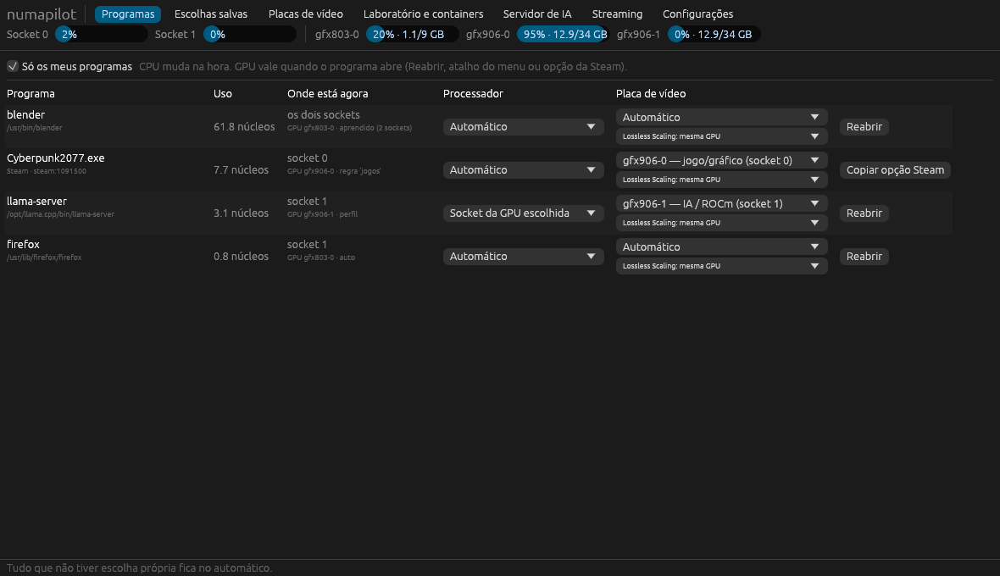

# numapilot

Escolhe **qual processador (socket NUMA), qual memória e qual GPU** cada programa usa,
em máquinas com 2 sockets. Feito para um servidor com 2× Xeon E5-2696 v4, 2× MI50 e 1× RX470
no CachyOS, mas funciona em qualquer Linux.

- **Automático (padrão):** um daemon observa os programas, coloca cada um no socket mais
  adequado e move a memória junto. Só usa os dois sockets quando o programa satura um deles.
- **Manual:** você decide o socket e a GPU, por comando (`numapilot run`) ou por regra no
  `/etc/numapilot.toml`.
- **Interface gráfica (`numapilot-gui`):** lista os programas abertos e deixa escolher, por
  programa, o processador e a placa de vídeo. O padrão é tudo no automático.
- **gfx906-rocm:** instala, atualiza, testa e faz rollback dos ROCm da comunidade para as MI50,
  sem mexer no ROCm do sistema.



## 1. Antes de tudo: BIOS

Na BIOS, **NUMA ligado / "Node Interleaving" desligado**. Se o `numapilot topo` mostrar só
1 nó com 2 sockets, ele avisa. Se alguma GPU aparecer com `nó ?`, defina o socket dela em
`[gpu_node]` no config.

## 2. Instalar

```bash
git clone <este repositório> numapilot && cd numapilot
./install.sh          # compila, instala em /usr/local/bin, cria o atalho no menu e ativa o serviço
numapilot topo        # nós, núcleos, RAM, GPUs e em qual socket cada GPU está
```

Para remover: `./uninstall.sh`.

## 3. Modo automático (o daemon)

Ele já fica rodando depois do `install.sh`. Para cada programa de usuário:

| Situação | O que o daemon faz |
|---|---|
| O programa casa com uma regra do config | Aplica a regra na hora (antes de alocar muita memória) |
| É filho de um programa com regra (ex.: jogo aberto pela Steam) | Herda a decisão |
| Abre uma GPU (`/dev/dri/renderD*`) | Vai para o **socket ligado àquela GPU** |
| Usa CPU (≥ 0,5 núcleo por 3 s) sem GPU | Vai para o **socket menos ocupado** com RAM livre |
| Usa ≥ 85% dos CPUs do socket por 10 s | **Expande para os 2 sockets** e grava isso |
| Expandido, mas usando < 30% de um socket por 2 min | Volta para 1 socket |
| Já foi visto antes | Começa direto no lugar aprendido (2 sockets, ou o socket da GPU dele) |

O daemon não mexe em processos do sistema, em programas abertos com `numapilot run` no modo
manual, em programas fixados com `numapilot pin`, nem em quem já definiu a própria afinidade
(ex.: `taskset`). Ao parar o serviço, ele devolve todos os CPUs para os processos que moveu.

```bash
numapilot status                  # o que está sendo gerenciado agora
numapilot learned                 # o que ele aprendeu
sudo numapilot learned --forget blender
journalctl -u numapilot -f        # decisões em tempo real
```

## 4. Interface gráfica

Abra **numapilot** no menu (ou `numapilot-gui`). O daemon em segundo plano mapeia cada programa
aberto, e ele aparece na lista agrupado por programa. Os jogos da Steam são agrupados pelo AppId.

- **Processador:** Automático, Socket da GPU escolhida, Só o socket 0/1 ou Os dois sockets.
  A troca vale **na hora**: o processo e a memória dele mudam de socket.
- **Placa de vídeo:** Automático, a placa de vídeo, cada MI50 como **jogo/gráfico** ou
  **IA/ROCm**, ou Nenhuma. A GPU só pode ser escolhida quando o programa abre, então a escolha
  fica salva e vale na próxima abertura. Para valer sem digitar comandos:
  - programas comuns: **Reabrir** (fecha e abre já na GPU nova) ou **Usar no menu**. Esse botão
    cria uma cópia do atalho em `~/.local/share/applications` que abre o programa pelo numapilot.
  - jogos da Steam: **Copiar opção Steam** e cole `numapilot run -- %command%` em
    Propriedades → Opções de inicialização. É uma vez por jogo; depois, a GPU escolhida na interface vale sempre.
- **Lossless Scaling:** em qual GPU o lsfg-vk gera os quadros (veja a seção 6).
- A aba **Escolhas salvas** mostra o que não está no automático e permite voltar ao automático.

As escolhas ficam em `/var/lib/numapilot/profiles.json`. Na linha de comando, use
`numapilot profile list|set|rm`.

## 5. Escolher GPU e socket ao abrir um programa (linha de comando)

A GPU só pode ser escolhida **quando o programa abre** (por variáveis de ambiente), por isso
existe o `numapilot run`. Sem opções, ele decide sozinho:

```bash
numapilot run -- blender                    # automático
numapilot run -n -- llama-server -m x.gguf  # -n: só mostra o que faria, e por quê
```

Manual:

```bash
numapilot run --gpu display --cpu gpu -- ./jogo        # RX470 + o socket dela
numapilot run --gpu gfx906-1 --use graphics -- %command% # jogo renderizado numa MI50
numapilot run --gpu gfx906-1 -- llama-server ...        # MI50 específica (socket dela)
numapilot run --gpu compute:all --cpu all -- python treino.py   # as 2 MI50 + 2 sockets
numapilot run --cpu 0 --gpu none -- ffmpeg ...           # só o socket 0
numapilot run --cpu all --mem interleave -- ./banco-de-dados
```

| Opção | Valores |
|---|---|
| `--cpu` | `auto`, `all`, `gpu` (socket da GPU), `0`, `1`, `0,1`, `cpus:0-21` |
| `--gpu` | `auto`, `display`, `compute`, `compute:2`, `compute:all`, `none`, apelido ou PCI |
| `--mem` | `local` (padrão), `interleave`, `bind` |
| `--use` | `auto`, `graphics` (jogo, inclusive numa MI50), `compute` (ROCm) |
| `--fg-gpu` | GPU do frame generation do Lossless Scaling (padrão: a mesma do jogo) |

No automático, a GPU de vídeo (com monitor) vai para programas gráficos. As MI50 vão para
programas de IA/computação conhecidos (`llama-*`, `ollama`, `comfyui`, `vllm`, `whisper*`...;
lista em `compute_hints`), sempre a **menos ocupada** (uso + VRAM). O socket é o da GPU escolhida.

O que ele configura: `DRI_PRIME=pci-...` para OpenGL/Vulkan (o `MESA_VK_DEVICE_SELECT` só é usado
quando o ID da placa é único; as duas MI50 têm o mesmo ID), `LSFGVK_GPU` para o Lossless Scaling, e
`ROCR_VISIBLE_DEVICES` (UUID da MI50, que esconde a RX470 do ROCm) para ROCm/HIP. Também exporta
`NUMAPILOT_CPUS`, `NUMAPILOT_MEMS` e `NUMAPILOT_RENDER` para scripts e containers.

**Steam:** nas opções de inicialização do jogo, use `numapilot run --gpu display -- %command%`.
A regra `jogos` do config já cobre a Steam inteira pelo daemon.

Para um processo que já está rodando: `sudo numapilot pin <pid> --cpu 1` (move os CPUs e a RAM).

## 6. Jogos nas MI50 e Lossless Scaling

**Jogar numa MI50:** escolha "gfx906-N — jogo/gráfico" na interface, ou `--use graphics`.
- Com o monitor ligado na própria MI50, ela renderiza e exibe direto. O numapilot reconhece a
  placa como MI50 mesmo com monitor ligado.
- Com o monitor na RX470, a MI50 renderiza e cada quadro é copiado para a RX470 (PRIME
  offload). Nesse caso, prefira a MI50 do mesmo socket da RX470.
- Para o automático mandar todos os jogos para uma MI50, defina `graphics_gpu = "gfx906-1"` no config.

**Lossless Scaling no Linux (lsfg-vk):**
- O lsfg-vk oficial gera os quadros **na mesma GPU do jogo**. Dual GPU ainda não é suportado,
  e o numapilot já aponta o `LSFGVK_GPU` para a GPU do jogo.
- Para dual GPU (jogo numa MI50, frame generation na outra, com o monitor ligado nela), é
  preciso um fork do lsfg-vk com essa função. Em "Lossless Scaling" na interface (ou
  `--fg-gpu`), escolha a outra GPU: o numapilot exporta `LSFGVK_GPU` com ela. Isso é
  experimental e depende do fork respeitar essa variável.

## 7. Regras manuais permanentes

Edite `/etc/numapilot.toml` (exemplo comentado incluído) e rode `sudo systemctl restart numapilot`:

```toml
[aliases]
"0000:03:00.0" = "rx470"
"0000:04:00.0" = "mi50a"

[[rule]]
name = "jogos"
match = ["steam", "*.exe", "gamescope"]
cpu = "gpu"        # socket da RX470
gpu = "display"
reserve = true     # o automático evita pôr outras cargas pesadas nesse socket
```

## 8. MI50 com o ROCm da comunidade (`gfx906-rocm`)

A AMD tirou a gfx906 dos builds oficiais, mas o compilador ainda suporta ela. Existem dois caminhos
mantidos pela comunidade, e o script cuida dos dois:

### a) Container: o mais fácil de manter

Usa a imagem do projeto **mixa3607/ML-gfx906** (ROCm 10.1 para gfx906, compilado via TheRock; 7.14 e 10.0 também existem: troque `IMAGE` no config).
Isso não depende das bibliotecas do CachyOS. O host só precisa do driver `amdgpu`, que já vem no kernel.

```bash
sudo pacman -S podman
gfx906-rocm container pull                       # atualizar = rodar de novo / trocar a tag
numapilot run --gpu gfx906-1 -- gfx906-rocm container run -- rocminfo
```

O container recebe só a(s) MI50 escolhida(s) pelo numapilot (`NUMAPILOT_RENDER`) e os CPUs do
socket dela. O mesmo projeto também tem imagens prontas de PyTorch, ComfyUI e llama.cpp.

### b) Nativo (tarball lado a lado)

Cada versão fica em `/opt/rocm-gfx906/<versão>`. `current` aponta para a ativa e `previous` para
a anterior. Nada vai para o PATH global, então não briga com o ROCm do pacman.

```bash
sudo gfx906-rocm update --check   # há versão nova?
sudo gfx906-rocm update           # baixa, testa nas MI50 e só ativa se passar
gfx906-rocm list
sudo gfx906-rocm rollback         # voltou algo quebrado? volta para a anterior
sudo gfx906-rocm prune 2          # limpa as antigas
gfx906-rocm doctor                # driver, /dev/kfd, grupos, GPUs, conflitos

# usar
numapilot run --gpu compute -- gfx906-rocm exec -- llama-server -m modelo.gguf -ngl 99
eval "$(gfx906-rocm env)"         # ou carregar no shell atual
```

O `update` procura, por padrão, os tarballs noturnos do TheRock com `gfx906` no nome
(`INDEX_URL`/`FILTER` em `/etc/gfx906-rocm.conf`). Também dá para instalar qualquer tarball
(ex.: um build seu ou de outro mantenedor): `sudo gfx906-rocm install <url-ou-arquivo> [nome]`.
O teste roda `rocminfo` e compila e executa um kernel HIP em cada MI50. Se falhar, a versão nova
fica instalada, mas **não é ativada**.

Para manutenção automática, crie um timer do systemd que rode `gfx906-rocm update` uma vez por
semana. Como ele só ativa versões que passam no teste, é seguro.

Dicas da comunidade para gfx906:

- Compile seus programas com `--offload-arch=gfx906` (ou `AMDGPU_TARGETS=gfx906`).
- Builds antigos do ROCm 6.x precisavam de `HSA_OVERRIDE_GFX_VERSION=9.0.6`. Os builds próprios
  para gfx906 não precisam.
- Usuário nos grupos `render` e `video` (o `doctor` verifica).

## 9. Laboratório de ciência de dados e ML nas MI50 (`gfx906-rocm lab`)

Um container com tudo pronto para usar as MI50. É construído sobre o PyTorch compilado para gfx906
pela comunidade (mixa3607/ML-gfx906) e ganha:

- **Dados/ciência:** numpy, scipy, pandas, polars, pyarrow, duckdb, numba, scikit-learn,
  scikit-image, statsmodels, sympy, networkx
- **Visualização:** matplotlib, seaborn, plotly, altair, ipywidgets
- **ML clássico:** xgboost, lightgbm, catboost, optuna, shap, mlflow, tensorboard. Esses rodam na
  CPU, que aqui são 88 threads; o PyPI não tem builds deles para ROCm.
- **Deep learning (na GPU, via PyTorch):** transformers, datasets, accelerate, peft, lightning,
  torchmetrics, timm, kornia
- **Ferramentas:** JupyterLab, VS Code no navegador (code-server, com as extensões Python e Jupyter),
  SSH, ruff, pytest, nvtop, git, opcionalmente o PyCharm

O PyTorch gfx906 da imagem fica **travado** no build: nenhum pacote pode trocá-lo por um build CUDA do PyPI.

```bash
sudo pacman -S podman          # recomendado (sem root); docker também funciona
gfx906-rocm lab up             # constrói na 1ª vez (a base tem vários GB) e sobe
gfx906-rocm lab                # mostra os endereços, o token e a senha
gfx906-rocm lab test           # PyTorch enxerga as MI50? faz conta em cada uma?
gfx906-rocm lab shell          # terminal dentro do container
gfx906-rocm lab down
```

| Serviço | Endereço |
|---|---|
| JupyterLab | `http://127.0.0.1:8888/lab?token=...` |
| VS Code (navegador) | `http://127.0.0.1:8443` (a senha é o mesmo token) |
| SSH | `ssh -p 2222 root@127.0.0.1` (usa as suas chaves de `~/.ssh`) |

Os projetos ficam em `~/lab` (no container: `/workspace`). Os modelos baixados ficam no cache do
Hugging Face do host (`~/.cache/huggingface`), então não são baixados de novo.

**Editores no host:**
- **VS Code (desktop):** use a extensão *Remote - SSH* com `Host gfx906-lab`, `HostName 127.0.0.1`,
  `Port 2222`, `User root`. Outra opção é *Dev Containers → Attach to Running Container*; com podman,
  configure `"dev.containers.dockerPath": "podman"`.
- **PyCharm:** o interpretador remoto por SSH (`/usr/bin/python3` em `127.0.0.1:2222`) é recurso da
  versão paga. Sem ela, defina `LAB_PYCHARM=1` em `/etc/gfx906-rocm.conf`, rode `gfx906-rocm lab build`
  e depois `gfx906-rocm lab pycharm`: o PyCharm roda **dentro** do container e a janela abre na sua tela.

**Atualizar com segurança:**

```bash
gfx906-rocm lab update --check   # há base nova (PyTorch/ROCm)?
gfx906-rocm lab update           # reconstrói, testa nas GPUs e volta sozinho se falhar
gfx906-rocm lab update --force   # mesma base, mas atualiza todos os pacotes Python
gfx906-rocm lab rollback         # volta para a imagem anterior
```

Por padrão, o update usa sempre a tag mais nova (`vX.Y.Z-rocm-A.B`). Para ficar numa versão,
defina `LAB_BASE` no config. Há relatos de falha em multi-GPU com ROCm novo em algumas máquinas
(issue #28 do ML-gfx906). Se acontecer, fixe uma base 7.2.x.

**Com o numapilot:** para dedicar uma MI50 ao laboratório e deixar a outra livre para jogos, use
`numapilot run --gpu gfx906-1 --use compute -- gfx906-rocm lab up`. O container recebe só aquela
GPU e os CPUs do socket dela.

Para acessar de outro computador da rede, use `LAB_BIND="0.0.0.0"`. O acesso continua protegido por
token, senha e chave SSH.

## 10. Limitações

- O daemon troca CPU e memória de programas em execução, mas não a GPU (isso exige `numapilot run`).
- Programas Vulkan de computação (ex.: llama.cpp com backend Vulkan) escolhem a GPU pelo índice
  próprio (`GGML_VK_VISIBLE_DEVICES`). O numapilot ainda não configura isso.
- No CachyOS, os schedulers sched-ext (scx_*) e o ananicy-cpp convivem com o numapilot, porque
  respeitam a afinidade de CPU. Vale medir com e sem.
- Ganho esperado em jogos: frametime mais estável e menos stutter. O teto continua sendo o clock
  do Broadwell.

## Arquitetura do código

```
src/bin/numapilot-gui.rs  interface gráfica (egui)
src/ctl.rs      socket de controle do daemon (a interface fala por ele)
src/profiles.rs escolhas por programa
src/desktop.rs  atalhos do menu que abrem pelo numapilot
container/      imagem do laboratório (Containerfile, pacotes, lab-start)
src/topo.rs     nós NUMA, núcleos, RAM, GPUs (PCI, socket, KFD/gfx, UUID ROCm, monitor)
src/decide.rs   decisão de GPU + socket (usada pelo `run`)
src/daemon.rs   modo automático (observa /proc, aplica afinidade, migra memória)
src/procfs.rs   leitura do /proc + sched_setaffinity, set_mempolicy, migrate_pages
src/config.rs   /etc/numapilot.toml
src/learned.rs  /var/lib/numapilot/learned.json
```

`cargo test` roda os testes, incluindo uma simulação desta máquina (2×22c/44t, RX470 + 2×MI50)
com um sysfs falso.
